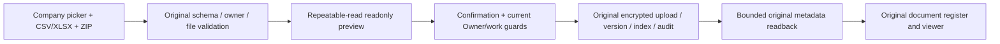

# Company documents through the original importer and master writer

The existing company page opens the existing import workbench in a company-document mode, with an actual company picker and optional source company ID for mismatch checks. CSV/XLSX plus ZIP refer to existing companies only. No document library, company, Auth account, financial transaction, migration or implicit document approval is added. The actual company catalogue supplies labels; users need not enter a UUID when choosing the company in the form.

The exact original master input and ownership-context validation are shared with normal upload. Company documents cannot target investor-private evidence, bank/user/employee libraries, replace historical versions or infer another owner. The existing parser accepts supported PDF/PNG/JPEG ZIP attachments; other formats use the existing manual path. Document date remains document date, without inventing expiry or reviewed licence/certificate status.

Preview is repeatable-read/read-only and excluded from write-receipt caching. Source/ZIP, actual operator/tenant, current company facts, requested duplicate counts and rows are bound to its signed token. Queries return grouped requested company/category/digest facts, not historical payloads. Unknown owners/columns and missing/unsupported files remain visible with field errors. Unmatched ZIP entries stop apply. Explicit skip of review rows preserves their report. Limits are25 preview rows and5 valid files per transaction.

Apply defaults disabled in server configuration. Actual active Owner, original work guard, recoverable store, original role/company lock order and fresh preview are required before save/cache replay. Missing work protection refuses before invalid input or previous success. Competing imports serialize before fresh duplicate review. Each original upload uses its scanner, retained encrypted file recovery, version/index and original audit with source/ZIP/row provenance. Late batch failure rolls back original rows/audit/receipt, retaining only encrypted objects for exact-key retry. No overwrite/cleanup or historical recalculation occurs.

Readback fetches at most5 requested original company version metadata records, checking IDs/company/source SHA256 without downloading files. The workbench preserves body/key for unknown save outcomes and performs GET-only readback recovery after successful save. Saving/scanning/authenticity approval are separate. Result table and CSV distinguish saved and review rows.

Eleven linked original API/master/investor/import-work cases pass, plus focused work-guard checks: default-off apply; unchanged readonly preview; company selection/mismatch; invalid owner category; original bytes/version recovery after rollback; exact cache replay; stale-token refusal; metadata readback; worker denial; missing work guard before cached success. Browser journeys pass default-off preview and explicit synthetic apply with lost-save/failed-readback recovery, original company-page button and AR/EN desktop/tablet/phone. TypeScript/build and189 root cases pass on recorded source. The enlarged52-journey suite has not yet passed as a whole. Frozen e030 remains49 UI passes and945/946 backend with its documented old scanner fixture failure.

All apply/data activity is local synthetic. Broader customer/vehicle files-only, bank/private-document adapters, structured licence/expiry relationships, historical reconciliation, full source-scope integration and final acceptance remain incomplete. Financial95 is not promoted; PR115 is unchanged. No real import, merge or deployment occurred.
