# تدفقات النسخة التشغيلية — نطاق المراجعة

الرسوم تشرح مصدر الحالة، وليست إثباتاً على نشر أو اكتمال البنود الموضحة «متبقي».

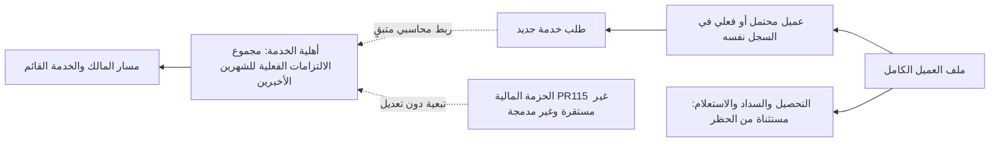

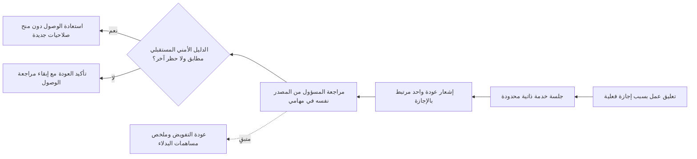

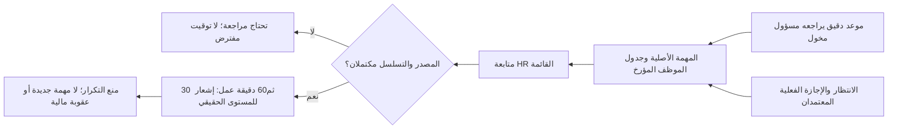

## Existing leave-linked delegation

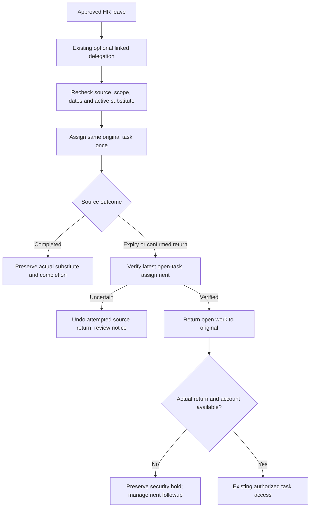

## Original conversation topics and tasks

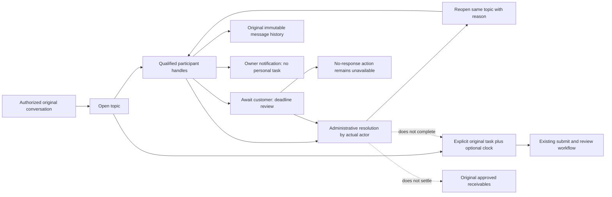

## Explicit employee standard reset

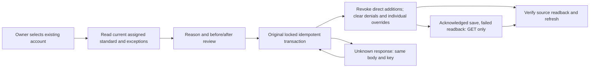

Assigned role, company/unit scope, standard definitions, other users and financial records stay unchanged. Unknown legacy overrides/downstream grants require review before any reset.

### Reassigned task with a recorded clock

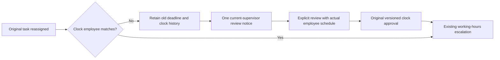

This review does not automatically extend a deadline or assign historic delay to a substitute. Terminal tasks do not generate review notices.

## Read-only Owner backup status (default disabled)

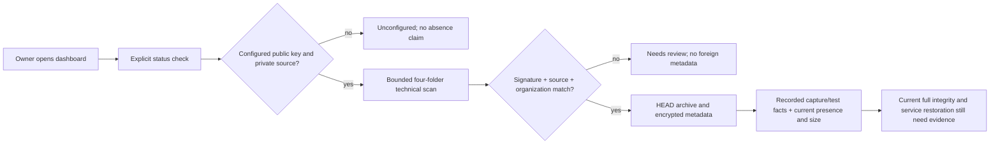

The display cannot start capture, download archives, change a schedule or run restore. The protected original backup job may publish an optional signed technical companion only after its original checks. Its private signing key remains outside application runtime. Independent storage and real restore acceptance remain release prerequisites.

## Existing customer/vehicle CSV workbench (unpublished)

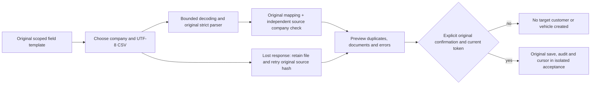

No finance or historical balances are imported. Real operating-data import remains prohibited pending final approval and backup. This diagram does not claim missing entity adapters are implemented.

### Explicit original conversation-task successor (unpublished)

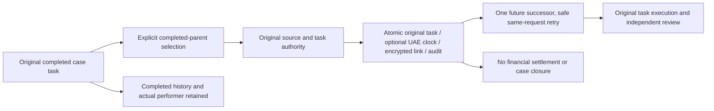

### Dated operating-centre administration (unpublished)

```mermaid
flowchart LR
  A[Owner in original employee permission page] --> B[Explicit recorded centre source read]
  B --> C[Latest recorded and immutable dated history]
  C --> D[Draft actual location and company links]
  D --> E[Fresh original before/after and retained future snapshots]
  E --> F[Explicit confirmation with original request receipt]
  F --> G[One immutable snapshot and encrypted audit]
  F --> H[Uncertain reply: same body and key]
  H --> G
  G --> I[GET-only verification and dated history]
  I --> J[Separate future employee scope review]
```

A centre-directory change does not update employee memberships, grant rights or move financial balances. Primary work location is separate from authorized scope. Stable referential identity and effective geographic scope enforcement remain unfinished; no hosted candidate installation is authorized during this build.

### Original work-account primary location (unpublished)

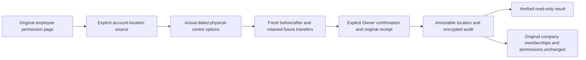

Null location is explicitly unassigned. Geographic access is a separate unfinished review/enforcement path. No HR employee or work account is manufactured from this source.
