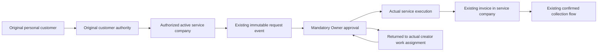

# Service company independence — unpublished actual API/UI fix

Residence/general request creation previously rejected any company different from the personal customer's legacy company, and the creation event used that legacy company. This prevented authorized independent service-company selection. The existing request stream/creator/draft/ledger are reused; no new request or finance system.

The form now gets a bounded authorized active-company choice from the original customer/edit and target-company view/edit policy. Actual names/licence references distinguish choices; unavailable saved choices retain their value with a human review label. Source, actor/session/locale/page guards reject obsolete setup/readback. Setup failures show a human message/reference and make no POST. New blank company selections cannot silently fall back on draft submission; older drafts with no company field retain their original fallback.

Creation retains original customer authority and independently verifies selected-company view/edit plus Active state. It saves the original immutable event on the selected company. Customer primary/residence company, original historical requests and balances are not transferred. Owner approval remains mandatory; fees remain AED and are not collected by recording a request. Existing request detail/list/history and native invoice routes use the actual service company. An inactive selection reports the specific company field.

Return-for-correction now resolves the creator's actual dated HR work assignment as well as legal employer. A workCompanyIds display value alone is not substituted for a dated assignment. The existing makeTask/employeeIn guards still validate it. One actual correction task appears in My Work, correction/resubmission completes that task, and the same request returns to Owner approval; no new grants or legal-employer change. Remaining leave/delegation sources and private relationship adapters are not claimed complete.

Validation: one coherent4-case native run covers original service cash-versus-bank, expenses/limits/no implicit payout and archival guards, plus independent residence/general company, draft/replay/no blank fallback, selected-company/inactive/denied permission, original invoice company and unchanged previous-company records. Cross-company return/revise/resubmit uses the actual creator/task, remains unpaid and needs Owner approval. TypeScript, provider-free build and189 static checks passed. Actual three-type browser flow passed, including a failed setup read/reference/no POST/retry, independent general company, mandatory approval, old residence expense/invoice/collection and vehicle form, create-form1440/768/390 and record AR/EN. A harness assertion was moved before dialog closure; no product assertion was weakened. The old out-of-company denial expectation intentionally changes409 to403: independent companies are valid with authority, and unauthorized selection remains denied.

SQL scope proposals remain uninstalled. This does not enable cross-branch collection, live service-eligibility blocking, geographic membership apply, external messaging or any real financial operation. Full later acceptance and protected release approval remain required.

