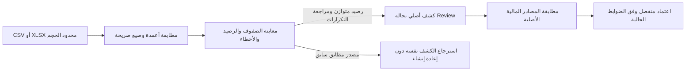

# استيراد كشف البطاقة على المحرك الأصلي — بناء فقط

امتداد لسجل البطاقة والكشف والمطابقة الموجود، وليس دفتر بطاقة أو نظام دفع موازياً. لا ترحيل أو اتصال بموفر أو تغيير مالي تاريخي.

- تنسيق التاريخ والفواصل العشرية يختار صراحة؛ لا تخمين لتاريخ ملتبس أو تحويل عملة أو تقريب مبلغ أثناء الاستيراد. المبالغ بدقة المحرك الأصلية، بما فيها الائتمانات والرصيد السالب.
- حدود CSV/XLSX والصفوف والأعمدة والعامل الأصلي المضغوط مطبقة قبل المعالجة. لا تنزيل أرشيف كشوف قديمة للمطابقة: استعلام محدود ثم مقارنة مجموعات الصفوف وتكرارها داخل PostgreSQL.
- التكرارات داخل الملف تبقى ظاهرة ولا تحذف تلقائياً. التأكيد يتطلب مراجعتها. إعادة رفع نسخة مرتبة بصورة مختلفة أو بصيغة أخرى تستعيد السجل الأصلي، بما فيه السجلات ذات البصمات القديمة.
- المعاينة مشفرة ومربوطة بالموظف والبطاقة والشركة والملف والمعادلة. تتغير صلاحيتها عند تعديل المدخلات؛ التأكيد يتحقق منها مجدداً ويستعيد النتيجة السابقة بأمان بعد انقطاع الاستجابة.
- صلاحيات البطاقة الشخصية تظل مقيدة بالمالك. لا يدل اقتراح نوع الصف على تصنيف مصروف أو ضريبة أو تحصيل أو سداد فعلي.
- لا ينشئ الاستيراد قيداً أو مصروفاً أو فاتورة أو سند قبض أو تسوية للمالك. لا يُعامل سند تسوية الشركة للمالك باعتباره إثبات سداد الجهة المصدرة.
- يعرض السجل اسم البطاقة والفترة والأرصدة بدلاً من المعرف التقني. يحتفظ المحرك بالمراجع الداخلية والبيانات القديمة.
- يُحتفظ ببصمة الملف والصفوف المطبعة والمستند المفحوص المرفق؛ لا تدعي هذه الإضافة أرشفة بايتات ملف الكشف الخام. مسار الفواتير الأصلي يحتفظ ببايتات مصدره كالسابق.

## الاختبارات

28 حالة خادم مرتبطة ناجحة، ثم 6 حالات نهائية للكشف والقوالب، بينها ملء قالب الفواتير CSV الفعلي ذي UTF-8 BOM، معاينته، إصدار فاتورة خدمة أصلية بقيمة 1.001 مرة واحدة وحفظ بايتات المصدر. إصلاح قارئ CSV المشترك يقبل BOM في البداية مع إبقاء حد الحجم والتحقق النهائي على الخادم.

متصفح فعلي ناجح: CSV بأعمدة مخصصة وفواصل عشرية، رفض الرصيد غير المتوازن مع بقاء البيانات، إبطال المعاينة عند التعديل، تأكيد أصلي، إعادة رفع XLSX معكوس الترتيب، مراجعة صفين متماثلين دون إسقاط أحدهما، وثبات أعداد القيود والسندات والمصروفات. العربية والإنجليزية وثلاثة مقاسات دون تجاوز العرض أو أخطاء JavaScript. 172 فحصاً ثابتاً وTypeScript والبناء المحمول ناجحة. الاختبار التراكمي الجديد جارٍ ويسجل منفصلاً عند اكتماله.

## ما بقي

المتطلبان 7.3 و7.6 ما زالا جزئيين: تصنيف جميع حالات الرد من المورد وربط ائتمان كشف البطاقة بإثبات سداد الجهة المصدرة يحتاجان استكمالاً على المطابقة الأصلية. إعداد ومعالجة قانونية أو ضريبية غير معتمدة لا يفترضها الاستيراد. لا نشر أو تطبيق على Supabase.
