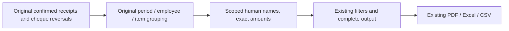

# E77 — Original collection report, human output

Build only. Extends the existing `/api/ledger/reports` and existing table/export/print UI. No second collection engine, task, receipt, balance, grant, migration or hosted change.

The original engine already grouped actual collections by day/month/year/executing employee/item. The employee/item grouping dimension was a technical identifier, and the original report had not opted into the shared human output. The projection now uses the actual receipt creator's available name and the original scoped item caption. A missing employee caption remains explicitly unavailable; another company's item caption is withheld. It does not substitute the currently assigned caller or infer employee productivity from money. Legacy API shape remains available without the opt-in presentation.

The same native amounts and dates remain authoritative: pending cheque excluded, clearing counted on clearing date, return deducted on reversal date; discounts and credit applications are not fresh money. Currencies remain separate. The source query, original financial permissions and export checks are unchanged. Company, grouping and numeric filters apply before the existing complete CSV/Excel/print path. There is no inferred income, VAT, certified closing or new posting.

Acceptance:12/12 related native tests,175/175 static tests, TypeScript and provider-free build passed. Native cases compare raw and human values in all five groups and both languages, confirm pending/cleared/returned cheque treatment and noncash discount exclusion, numeric filtering, foreign-company denial, exporter denial, technical-column rejection, missing/foreign captions and unchanged original journals/receipts/grants. The first test fixture correctly hit `priorityOverrideRequired`; its explicit synthetic Owner allocation now includes the existing override reason. No protection was changed.

Actual browser passed AR/EN, all five groups, three widths, original-source totals, original receipt executor/item names, actual private synthetic PDFs and Excel, with no journal/receipt changes or page errors. Logs:`/tmp/e77-collection-report-native.log`,`/tmp/e77-collection-report-browser.log`, and `/tmp/e77-collection-{type,static,build}.log`.

Requirement9.9 remains partial: this is another original report family, not acceptance of every dashboard/drilldown or all95 requirements. No deployment requested.
