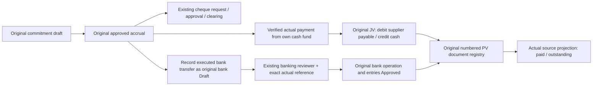

# E46 — native approved supplier payment methods (BUILD ONLY)

The original approved commitment created an accrued expense/payable and a native voucher. Its actual voucher preparation/approval/settlement path required an outgoing cheque. Cash funds and native bank operations already existed, but the original obligation did not connect those methods through to its payment status and original PV register. No parallel payable, expense or payment registry has been introduced.

## Original sources and protection

- Canonical `createFinanceOperation` is extracted from the original bank API with its same strict schema, active/company/currency bank selection, permissions, proof, cheque and Owner-payable guards, INSERT and audit. Both callers use the same database transaction. It does not execute a transfer at a bank.
- Cash uses the original posted journal and CPV metadata sources already supported by the financial document centre. It clears the original approved supplier liability, not a second expense. Only the actor's active normal AED cash fund is accepted, with existing settlement and fund-management rights, clean evidence, exact approved amount and sufficient actual posted balance. Petty cash retains its independent evidence-review workflow.
- Bank creation is a native Draft: it posts no entries, does not mark the liability paid and holds other payment methods until approved or explicitly rejected. The original banking approval additionally validates only explicitly versioned new commitment sources, including exact commitment/operation/company/currency/payable/amount/beneficiary/evidence/reference, current unreversed accrual and period controls. Ordinary legacy bank workflows keep their original behaviour.
- The original bank approval posts its entries and creates the original numbered CPV metadata atomically, with no extra GL journal or expense. A test-injected document failure proves status, entries and CPV all roll back; a subsequent valid retry creates them once.
- Company/reference reservation, original obligation locking and exact replay digest prevent concurrent duplicate payments, source reuse for another obligation and a changed retry. A rejected bank Draft remains in history; correction can use a new reviewed reference or another method without deleting the rejected source.
- A noncancelled existing cheque request blocks cash/bank methods. A paid or pending bank source blocks cancellation or a new cheque. Source reversals/inconsistency produce a review state rather than automatically recreating cash. Original generic manual-JV reversal cannot reverse the source document.
- Payment status is separate from accrual status and is projected from actual original journal entries, bank operation entries or native Paid voucher. Shared-company expense and mirrored intercompany attribution remain unchanged when the supplier is paid.
- The original PV register now includes this additional native cash-JV prefix. Where native cash/bank metadata has an issued CPV number it displays that number; otherwise the existing bank reference remains the fallback. No read allocates a number. Annotation uses the applicable original settlement permission.
- New failed bank approval requests have a safe reference and sanitized event/code/status log only: no account, amount, supplier, URL query or secret is logged.

## Activation and scope

Both new payment methods require the existing company-specific reviewed Owner financial feature approval `commitment_payments`; absent by default. This build writes that approval only in synthetic fixtures. It does not add a permission, role, hosted setting, migration or historical balance adoption. Full approved AED obligation amounts are supported by these methods; a changed/partial amount is explicitly rejected rather than silently changing the approved expense. Actual paid refunds/corrections require the appropriate financial procedure, not cancellation of the original accrued document. Shared VAT/recoverability and later intercompany settlement remain separately unresolved; paying the supplier does not settle another company's share automatically.

## Acceptance at this saved build

- Seven new native cases plus original commitment, shared-company, bank, fund-role and financial-register regressions: **25 passed, 0 failed**. Covers concurrent replay, exact 100.001 settlement, shared 60 / 40.001 expense, default-off activation, other company/holder, explicit scoped bank reviewer, rejected bank history, existing cheque, missing actual-payment confirmation, clean evidence, insufficient funds, reference reuse, forged source, no customer invoice, original grants unchanged and forced mid-transaction document failure.
- Actual original UI: retained wrong-amount inputs with safe trace, successful cash CPV, bank Draft not paid, wrong bank-reference rejection with retained inputs/trace, original banking approval, exactly one original PV per source, hidden repeat actions, actual paid/outstanding and human labels. Arabic/English at 1440/768/390 passed.
- Original financial-package browser regression passed, including delayed-response safety, documents, item settings and financial controls. TypeScript, **172 static tests** and portable runtime module-graph build passed.
- Logs: `/workspace/ab-test-tmp/commitment-payments-native-final.log`, `commitment-payments-browser.log`, `commitment-payments-original-browser.log`, `commitment-payments-static-final.log`, `commitment-payments-check-final.log`, `commitment-payments-build-final.log`.
- Prior exact E45 tree `5bbb6e5162a0270d93099e103f0e2ec205833558` (local `d546a58`, remote `4909fe6ff1343c197dcc4a4407e0e995dd537b79`) independently passed **525 cumulative native tests**, with tracked source unchanged throughout the complete run. This is prior immutable proof, not a claim that E46's new cases were included.

Requirement 4.2 is accepted as complete-unpublished for the original supplier-obligation payment cycle. All-95 acceptance remains incomplete. No merge, protected delivery run operation, Render change, original Supabase write or financial activation occurred.
