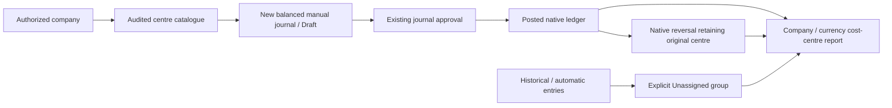

# Native cost-centre foundation — 21 November 2026

Scope: optional attribution of new manual journals in the existing company ledger. This is one part of the nine-phase financial order, not financial completion.

- Catalogue: encrypted `ab.settings`, company scoped, bilingual names, generated internal identifier, active status, optimistic revision, normalized-name uniqueness, immutable audit before/after.
- Authority: existing `ledger_configure` for catalogue writes, `ledger_view` for reads, existing journal creation and independent posting permissions. No grants are changed.
- New manual journals can select an active centre belonging to the same company. The server freezes the selected name/revision in the new journal. Editing a centre never edits an existing journal.
- Reversal copies the original attribution, including inactive centres, so the centre and ledger reconcile. Historic journals and automatic workflows without explicit attribution remain **Unassigned**.
- The native financial reports page adds cost-centre income/expense/net by company and currency, using posted journals and approved operation entries. It reuses existing Excel-compatible SpreadsheetML and print/PDF exports; it does not provide an invented XLSX format. This report fails closed beyond 10,000 source entries instead of silently truncating.
- No DDL, data migration, historical reclassification, invoice creation, cloud financial transaction or permission update is part of this change.

Verification: two new tests cover schema, same-company snapshot, normalized duplicates, revision conflicts, idempotent journal creation, cross-company rejection, Draft exclusion, posting, immutable name, inactive rejection, reversal, unassigned reconciliation, Excel export, denied users and company-scoped reads. The combined ledger/tax/cost-centre run passed 27 tests. Real financial-package browser passed catalogue creation/readback and journal selection/report across Arabic/English desktop/tablet/mobile, alongside existing financial-package regression. TypeScript, JS syntax and compiled-runtime build passed. Full exact-head CI remains a separate prerequisite for merge.

Limits: new automatic document workflows and split/per-line allocations are not assigned a cost centre automatically. No attribution is inferred from job titles, customer residence company or historical text. Tax, Owner personal-card and agency-accounting work remain separate entries in the master checklist.
