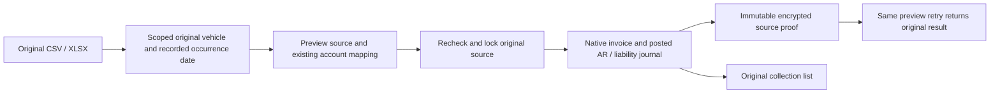

# Dated vehicle fines on the original invoice importer — build only

The existing CSV/XLSX row importer now verifies the original recorded vehicle/customer responsibility for dated traffic fines. It still creates the original invoice, original balanced journal and original collection source. It adds no ledger, government payment, receipt or historical reassignment. The original monthly Salik responsibility digest and dispatch are unchanged.

Fine rows require an existing active customer, original vehicle relationship, responsible legal company, actual nonfuture occurrence date, recorded registration start and recorded end/sale boundaries, plus an explicit source review. Same-day transfer/end boundaries and missing dates stop for review. Customer scope company and vehicle company may differ; the vehicle company governs the native invoice. No customer/company relation or historical debt is rewritten.

Existing bulk-enabled fine mapping must use receivables and a separate third-party liability, with its recorded zero tax rate. Conflicting operational account roles are rejected. This neither certifies VAT treatment nor proves a government payment or a customer collection. Owner-card operations and monthly Salik cannot be smuggled into this fine path.

Preview reads bounded requested identities and original events only, with request-local mapping caches and minimal customer columns. It does not download personal profiles or attachments. Source references use canonical money and identities; changing the amount, date, vehicle or mapping of an issued reference is a conflict. Legacy invoices without a verifiable source are reviewed, not adopted. The original file is retained encrypted byte-for-byte. A different mapping gets a separate review without overwriting its predecessor.

Before issuing anything, the transaction locks and rechecks original vehicle/item responsibility. A stale event, even without a vehicle revision increment, rejects the whole fine file. Native invoice and journal identity and amounts are checked before saving immutable source evidence. Concurrent approval and a manual retry after a lost response return the original result only after current customer/import authority is checked. The old generic completed-import contract remains unchanged.

The original invoice details can read the archived source under both invoice-company and actual customer scope. Current-context drift is a warning; saved proof is never replaced. Original parent-file metadata is Owner-only with its original import authority. No original blob or internal UUID is displayed in this review.

The original UI retains selected files in memory only. Mapping changes invalidate the preview; a monotonic input revision survives language changes. Company/actor context is captured before file reads and checked again after responses. Real network failure and uncertain commit outcomes preserve inputs and the same preview; no automatic financial retry is added. Verified approval remains successful if the subsequent read refresh fails. A genuine GET-only refresh action is available. Concurrent commit clicks and changes while issuing are blocked.

## Verification and honest limits

- 39/39 targeted native cases passed across original templates, monthly Salik, responsibility proof, ledger integration and six new fine cases. A final six-case run also passed after source privacy hardening.
- New real browser passed in Arabic/English at1440/768/390: preview-only authority, file retention, actual aborted request, stale company/input responses, actual server commit followed by a503, safe same-ID recovery, refresh failure after verified success, exactly one native invoice/journal and no cash/PV/grant change.
- Original financial package and dated Salik browser regressions passed. TypeScript,172 static cases and portable build passed. Original monthly Salik and ledger browsers with and without012 also passed, including partial receipts, statements and ageing. Complete cumulative acceptance is recorded separately when completed.
- Targeted testing caught an optional-column placement regression; the new date is now appended after the original eight columns. The original template expectation remains intact. A fixture attempted an invalid nullable customer-company setup; it was corrected to preserve the original NOT NULL schema, and actual cross-company behavior was tested instead.
- Browser testing caught a draft scope declaration in the wrong branch; it was corrected before any saved release. No such candidate was published. Original document upload regression remains part of the acceptance work.
- Draft CI44992177320 passed573 native and172 static tests but failed an existing card-browser response-before-render race. Its fix waits for the exact real backend error reference, with a deterministic held-error test; the original card browser passed locally. No financial response, protection, assertion or permission was bypassed.

Uncertain historical responsibility, inactive customer billing and final supply/VAT treatment remain explicit review boundaries. All95 requirements remain incomplete. No hosted query/write, migration, Reset/Restore, historical reclassification, new delivery request, protected run action, Render change or Production operation was performed.
