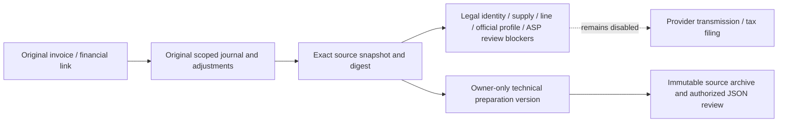

# E57 — original e-invoice source preparation (BUILD ONLY; partial3.8)

This is implemented preparation infrastructure, **not approved XML, accredited-provider exchange, tax approval or filing**. It reads original invoices/financial links, original posted invoice journal metadata and associated original adjustments. Source amounts, currency, recorded VAT and references are frozen in a scoped source digest; current item/proposed company tax values and a person's residence-company identity cannot fill missing legal fields or recalculate historical tax.

Native payload issue date, financial-link date, journal-effective day and original creation timestamp stay distinct. A missing original document issue date remains missing; an accounting-classification date is not silently treated as a tax issue date. Third-party/liability postings are flagged instead of becoming company sales. Original corrections are separate source references; original gross is not reissued as a new net invoice.

GET source review requires existing ledger view/report plus the original customer's company-view authority. Downloads additionally require original export authority, including saved versions. Technical save additionally requires existing configure and Owner authority; it is not financial or tax approval. The UI extends the original financial invoice detail, uses the existing forms/brand/AR-EN layout, shows the explicit blockers and has no provider-submit/tax-rate/identity-approval inputs.

Technical versions use encrypted settings in the existing **ledger business namespace**, original CSRF/idempotency and audit; no schema or Reset-policy change. Concurrent/different-request-key retries of the same source reuse one immutable version/note. Source changes reject stale save digests. Old versions remain readable, visibly distinguished from the current source, and validated against their source digest/context/disabled flags. There is no update/delete/transmit endpoint. This is not another financial ledger or a second invoice-number sequence.

No legal identity, TRN/TIN, address, units, supply treatment, schema version or provider is invented. `officialProfileVersion`/provider remain null; all validation/legal/tax/submission flags remain false. This is a source review packet, not an official PINT-AE validator. Fresh access to the pinned official resource was refused by the execution proxy with HTTP403 tunnel; the prior [official source review](einvoicing-official-source-review-2026-11-21.md) is retained. No non-AE schema is substituted. Official schema/business-rule validation, reviewed legal/profile data and accredited-provider sandbox acceptance remain outstanding; publication vs mandatory profile dates must be reviewed explicitly.

## Acceptance

- **17 native cases passed**: four new source/preparation cases plus original tax and financial-package regressions. Recorded VAT5.000 on gross105.000 remains the original value after proposed tax changes; the normal used-item edit correctly refuses rate mutation. A deliberately isolated legacy current-item metadata fixture also cannot replace original journal VAT. No hosted data was modified.
- Concurrent saves create one encrypted technical version and one audit; later original discount creates a new review context, refuses stale save and retains the old source unchanged. Export/configure/Owner/customer-company gates are distinct. Cross-company customer references retain the invoice's real company; the unauthorized person's scope is denied. Principal/third-party liability sources do not become sales; corrupt/borrowed packet contexts fail closed. Source rows, numbers and grants remain unchanged on reads/preparation.
- **Four actual browser suites passed:** new source review, original financial package,206-row document report and exact dashboard subsets. New suite covers Owner/reader/exporter, AR/EN at three widths, authorized JSON and history, and503 after **actual server commit** followed by manual retry recovering that same ID with one version. Notes/reference remain on failure; no false invoice/transmission success. Financial IDs/balances/effective rights are unchanged.
- Final TypeScript, **172 static tests**, portable build/module graph passed. Logs: `/workspace/ab-test-tmp/einvoice-source-*`. Frozen full acceptance: **568/568 native tests passed**, no failures/skips, 867354ms, on commit `dc9a54b068a32c90b4efc310d7726e63bb66d376`, tree `d28d87bb4b44fdcff8e9ea277950767abd09e524`; `/workspace/ab-test-tmp/financial-einvoice-source-cumulative.log`. No tracked files changed during that run. Previous immutable E56 source already passed564/564.

Requirement3.8 advances to **partial**, not complete. No schema migration, financial activation, source historical rewrite, original Supabase write, merge or Render deployment.
