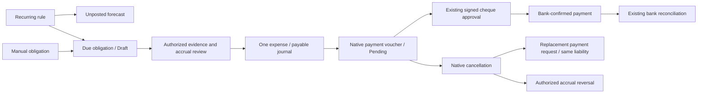

# Commitments and recurring obligations — completion build

New workflow orchestration reuses the existing company ledger, encrypted settings, document evidence, native payment vouchers, cheque approval and bank settlement. No parallel payment journal or chart is created, and no schema or historical migration runs.

## Implemented

- Company-scoped AED draft obligations with item, beneficiary, amount, due date and scanned supporting document. Draft creation has no financial effect.
- Existing `ledger_journal_approve` authority approves accrual with an explicit reason. The server validates expense/liability mappings and posts one balanced expense/payable journal on the current date. No VAT amount or deductibility is inferred.
- Existing `ledger_voucher_create` authority requests a native payment voucher against that accrued payable. The voucher carries the original payable chart and `alreadyAccrued` provenance, so native voucher approval cannot accrue the expense twice.
- A cancelled payment request may be replaced without another accrual; all previous voucher identifiers remain in the obligation history. The current voucher must be cancelled through its native controls before reversing the obligation. A paid voucher cannot be erased or silently reversed here.
- Reserved voucher source keys cannot be supplied through the general manual voucher API. Prepare/approval/settlement validate the exact obligation, amount, company, item, original payable and unreversed source journal.
- Monthly/annual rules, explicit start/end, disabled-by-default UI, audited activation, month-end/leap preservation and bounded forecasts. Generating due obligations creates drafts only, from rule creation onward, once per rule/date under transaction locks. There is no retrospective balance backfill or automatic expense/payment approval.
- Original terms are immutable when editing rules; change future economic terms by a separate reviewed rule. Existing approved records remain untouched.
- Bilingual responsive catalogue, row details, accrual review, cancellation, voucher request, recurrence forecast and generation actions. Existing petty-fund setup now proposes a 500 AED ceiling; opening cash still requires an explicit actual amount.

## Acceptance and limits

Isolated tests exercise concurrent approval/generation, idempotent creation/voucher requests, original payable attribution, cancellation/replacement, native cheque approval and bank settlement, zero payable after payment, absence of a second expense, disabled rules, prospective dates, company permissions, immutable grants and rejection of customer-held Work Amount as an expense mapping. Browser coverage exercises create/readback/approval/pending voucher in Arabic/English on desktop/tablet/mobile.

This does not finish all treasury requirements: supplier invoice VAT allocation, non-cheque payment expansion, shared-expense apportionment, employee advances, automated recurring scheduling and the Owner personal-card cycle remain separate checklist items. No cloud financial transactions or deployment occurred.
