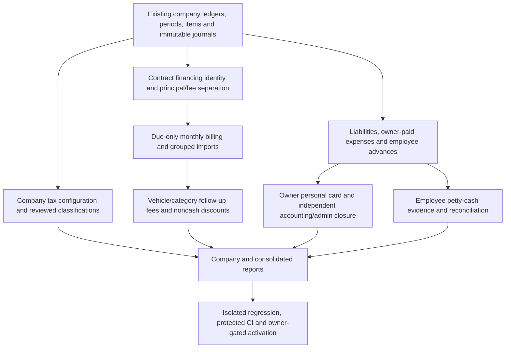

# Financial, treasury and tax delivery — 21 November 2026

Base: published PR108, commit 640339c7a3c5488d790b1e79a282e886beb2bc3b.
No source balance, permission, contract, worker setting or deployment setting is changed.

## Delivery dependencies

## First implementation: vehicle/category follow-up policy

The existing calendar-month rules cannot represent a strict 60-day delay.
`vehicle_category` is a new explicit calculation unit in the existing fee API/UI.
It requires monthly repetition, groups original unpaid invoices by vehicle and
original item in one legal company, and issues only on the first calendar day.
Exactly 60 days is not eligible. Original invoice due dates remain linked.
Partial principal is eligible; fully settled principal and fee-on-fee are not.
Ambiguous historical customer responsibility is held for review.
Source keys include company, vehicle, original item and month, rather than rule
identity, so a second rule or changed amount cannot charge the same unit twice.
The new unit uses a fixed 60-day policy; the retained delayMonths=2 field is only
backward-compatible storage, not the calculation. UI explains this explicitly.

Existing customer/item and per-invoice rules retain their original behavior.
No fee items or customer invoices are seeded. The existing contractual-evidence,
specific financial approval, prospective effective-date and default-disabled
guards remain authoritative. Earlier original debt is not silently made eligible.
Creating an invoice never proves collection. There are no SQL migrations here.

## Remaining work; not delivered by this change

1. Company tax registration/period and item tax classification, corporate-tax
   adjustments and UAE e-invoice readiness require a separate implemented package
   and current official legal-source review. No default tax treatment is assumed.
2. Cost centres, advances/external-party claims and recurring liabilities need
   native-ledger extensions, not a parallel financial database.
3. Due-only vehicle monthly billing and separate forecasts must be versioned;
   never reinterpret old schedules or issue all future monthly invoices.
4. Salik monthly aggregation must preserve original transaction responsibility
   and import hashes before posting native invoices.
5. Personal owner card, owner payable, cheque custody and proof of card repayment
   require distinct accounting and administrative states. Existing corporate-card
   records must not be relabelled as personal or automatically migrated.
6. Authorized collection-time discounts need the existing noncash engine and an
   atomic Owner notification; this change grants no new rights or limits.
7. Investor review PR73/controller PR72 and operating-billing PR89 must be rebased
   and reviewed independently; this order is not permission to apply their exact
   sensitive SQL silently. Existing historical contracts remain authoritative.

## Verification boundary

Pure policy tests cover first-of-month, strict 60/61-day boundaries, separate
vehicles, aggregation, partial/full settlement, scope, ambiguous debtors,
prospective revisions, replay across rule IDs and unchanged input records.
Full existing financial integration checks and native CI remain required before
merge. No hosted financial acceptance or tax filing is claimed.

Local verification: TypeScript, JavaScript syntax, whitespace and all four pure
policy tests (new vehicle unit and legacy fee/recurrence tests) pass. The eight
database integration cases could not create their isolated test databases:
PostgreSQL 53100, No space left on device. This is not a passing integration run.
The stale local test connection file was corrected from the existing local-only
fixture configuration; its previous file was preserved. No DB password changed.
No existing databases, volumes, backups or attachments were deleted for space.
Keep this PR draft pending complete native CI and a new-unit API/browser test.
