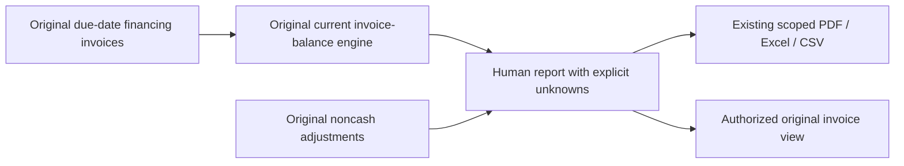

# E79 — Original financing installments and adjustment reports

Build only. Reuses `/api/ledger/reports`, the original invoice balance engine, original-record links and existing CSV/Excel/print/table tools. No parallel receivables, journal, schedule or tax-credit system.

Financing installments select original `kind=finance` invoices by their original due date. Linked invoice repayment, noncash credits, legal balance and book balance come from the existing balance engine. They are **current** balances, not reconstructed balances at the selected period end. Unlinked legacy accounting sources remain null and require review; the report does not adopt/repost them. Allocated repayment is not labelled fresh cash. Investor-managed rights remain explicitly distinct from company assets; financing ownership is not inferred for other invoices. No company-bank schedule is created or changed.

Adjustments show original invoice numbers, original amount and recorded waiver/write-off/rescheduling/termination kind, with UAE creation dates. They are not receipts or certified legal/tax credit notes. No inferred signed reduction, posted status, tax treatment or new document number.

The new projection reads the selected dates/company/currency/item/executor only, uses bounded source facts and calls the original invoice balance engine by selected IDs/company. Oversized results fail without truncation. Legacy unflagged reports retain their shape. Complete output includes all filtered rows beyond page200, omits technical identifiers and keeps numeric conditions.

Existing report authority does not grant export or native invoice opening. JSON supplies opaque row keys and original invoice links only with the existing native ledger-view and contracting authority; every original source endpoint checks again. Opening a row uses the same actor/locale/report/input-revision guard as journal/bank links. A late invoice result cannot open after changing the report filter. No new role/grant.

Final acceptance:9/9 related native cases (3new) passed, including202 original contract installments beyond page200, current repayment after the report period versus no inferred period-end balance, unknown unlinked balances, source/filter/export/foreign-company boundaries, unchanged original invoices/entries/grants and opaque output. The fixture initially hit existing `invalidTargetInvoice` when it omitted the vehicle scope; it now uses the original canonical invoice collection endpoint. No guard was loosened.

Actual browser passed installment/adjustment reports AR/EN, three widths, known/unknown current balances, original invoice row opening, late-source discard, four real PDFs and Excel, with no receipt/journal changes or page errors.175/175 static checks, TypeScript and provider-free build passed. Final source text explicitly distinguishes original documents from certified posted sources and labels due date versus UAE adjustment-recording date; the9/9 native cases and actual four-PDF browser passed again on that source. Original GL/journal, collections and financial-package browsers also passed. Logs:`/tmp/e79-invoice-report-final-native.log`,`/tmp/e79-invoice-report-final-browser.log`,`/tmp/e79-invoice-report-final-{type,build}.log`,`/tmp/e79-invoice-report-static.log`,`/tmp/e79-invoice-report-browser-regressions.log`.

Requirements9.5/9.9 remain partial: operational source output does not finalize agency accounting, bank liability reporting, tax treatment or every dashboard/drilldown. No original Supabase access, historical classification, protected workflow action or delivery request.
