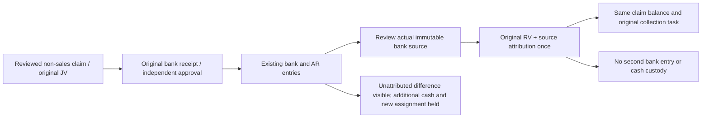

# Original non-sales claim bank receipts — E43

Build only. Neither this proposal nor any hosted data was applied or changed. No deployment/merge requested.

## Flow and original sources

The original bank operation must already be an Approved AED receipt with exactly matching company, dedicated claim receivable, immutable claim reference, party identity and clean original evidence. It cannot be a sales/customer/vehicle allocation, cheque, Draft operation, another claim's payment, future receipt or a receipt predating recognition. A full actual operation is attributed to one claim; partial claim repayment is supported through separate actual bank operations. Splitting one operation across unrelated claims is deliberately unsupported, not guessed.

The original `finance_receipts` register issues one numbered non-sales transfer RV; the original source operation is retained in `deposit_operation_id`. No fake customer, invoice, cash handover, bank journal, revenue, VAT, expense or Owner debt is created by this attribution. Repeated requests/concurrent submissions return the same RV. Native RV documents show the claim and named party. The customer-only workbench receipt projection deliberately remains unchanged.

## Reconciliation, permissions and protection

- Claim balances combine their original posted journals and actual approved bank entries by source in batched reads. Cash plus bank partials reconcile exactly with the original AR.
- A bank receipt can credit AR before it is attributed. The register exposes attributed claims, actual book balance and difference by account. Additional cash collection, a new approval on an inconsistent account, and new collection assignment fail closed until the difference is reconciled. An unrelated reconciled receivable account remains independent. No pending receipt is silently converted into revenue or an automatic allocation.
- Existing company `ledger_collect` and bank-view authority are required. A debtor cannot verify their own repayment. No existing grants or job-title-derived rights are added. Read-review failures carry a safe server trace; logs contain sanitized event/code/status/reference, not URL query, bank evidence or personal data.
- Original cash custody guard is untouched. Transfer RVs cannot become employee cash custody.
- `manual-claim-bank-receipts.review-only.sql` is **outside all delivery catalogs**. It checks the exact reviewed original trigger SHA before adding a nullable, FK-constrained, unique original-operation source and extending the deferred receipt guard. The original cash journal/amount/principal checks remain. Bank source, company, AR, full amount, date, claim, cleared transfer RV and absence of cash custody are checked independently by PostgreSQL.
- The separate bank marker defaults absent, so bank actions remain unavailable until explicit future migration review. Existing cash marker and cash behavior remain valid. Only random isolated test DBs apply the proposal.

## Root cause fixed in task integration

The first actual bank-RV task test failed with `approvedReceiptRequired`: the original collection-task source query required `receipt:<RV>` cash journal existence. A correctly linked bank RV has the approved bank operation's existing entries instead. The query now verifies that original source for transfers and preserves the original non-reversed cash-journal branch. JSON access to the nullable new source keeps original-schema reads compatible. No second task system or fake cash journal was added.

## Accepted tests

- Six new native cases plus original claims/task regression: **10 passed**. Actual 25.001 bank + 75.000 cash closes 100.001 exactly; concurrent attribution once; expected-amount mismatch; actual employee bank recovery independently verified; wrong claim/party, Draft, customer source, excess, own-debtor and company-scope refusal; unchanged entries/grants; forged cross-claim RV rejected at deferred commit; absent marker and changed original trigger rejected; approved bank RV closes the one original collection task without posting or creating a next task; an unmatched source affects only its own AR account and an independent claim still approves and collects normally.
- Actual original browser passed: missing bank reference retains reason/input and trace, submit waits for preview, changing source invalidates preview, success closes form, partial claim refreshes, native RV opens with the proper named party, no new GL or cash custody, AR/EN at desktop/tablet/phone widths.
- TypeScript and all **172 static/regression checks** passed. Portable runtime graph build passed without provider connections.
- Earlier 514-test local cumulative run passed but files for E43 were being built during that run; it is **not an immutable-commit acceptance proof for E43**. Exact E42 draft CI independently passed the native authorization/RLS/restore stage. A fresh saved-source cumulative run follows this checkpoint.

## Remaining limits and recovery plan

The broader manual-claims requirement remains partial: reviewed noncash/custody/source extensions are not activated on Staging, and refund/correction after actual collection still requires the original documented financial procedure. An unrecognized bank operation or difference is shown and held, never silently repaired. No historical reclassification or claim adoption occurred.

Before a future approved activation, rehearse all dependent proposals transactionally and preserve a verified backup. **After a bank-source RV exists, do not roll back to an old claim-balance reader that ignores bank sources**; keep compatible readers and forward-fix. Do not delete receipts, drop source history or modify approved bank entries to simulate rollback. Failed migration before any new source is used can roll back as one transaction. Final Owner release review must include this reader-compatibility constraint.
