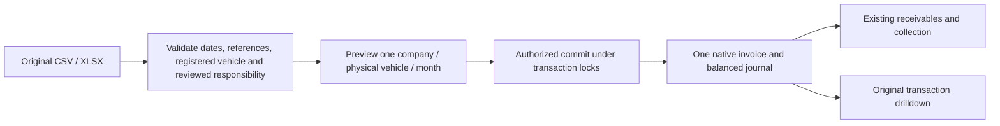

# Monthly toll imports — build-only acceptance

No deployment, source migration, cloud financial writes, historical reclassification or change to existing item/account mappings.

The existing invoice importer now offers monthly Salik grouping and empty CSV/true XLSX templates with original transaction dates. It reuses finance_invoice_imports, vehicle_invoices, finance_invoice_links and the native balanced journal engine. Full original files and transaction detail are retained encrypted; invoice drilldown checks company and customer access.

Amounts use existing integer thousandths, never floating-point summation. A vehicle/month cannot mix customer responsibility, due dates or items without review. Different vehicles produce independent invoices. Transaction references are reserved per company, with content fingerprints; changed-file reimports cannot reissue transactions. A repeated completed commit returns its original result only after authorization. Vehicle revision is rechecked under lock. A second invoice for an already issued vehicle/month is blocked; late additional transactions need approved correction rather than silently rewriting a posted invoice.

New bulk Salik invoices must use this grouping path. Existing invoice history is unchanged; the generic independent-row importer remains available for other items. The manual invoice workflow is retained. The pass-through path requires an explicitly configured liability counterpart with zero tax in the current native engine. It refuses an income mapping or unresolved tax treatment instead of modifying accounting configuration. This does not decide VAT treatment or implement asset-reimbursement accounting.

Transaction-time responsibility is deliberately conservative: the registered vehicle's current customer/company must still match its original request, registration must precede the transaction, and the authorized user explicitly reviews source responsibility. Changed/ambiguous historical relationships are blocked. Requirement 5.6 remains partial until full authoritative responsibility history and exception handling are accepted. Existing legacy source-reference collisions require review; no historical import backfill is performed.

Acceptance: 28 native template/import/ledger tests passed, including pass-through accounting, exact fractions, two vehicles, duplicates, conflicting references, late transactions, unauthorized detail access and unauthorized commit replay. The independent browser suite passed real CSV preview/commit, template download and transaction drilldown in the existing UI, AR/EN and 1440/768/390 viewports. 172 static regressions, TypeScript and the portable runtime build passed. Tests use disposable synthetic loopback databases and fake providers only. Full cumulative CI remains required before final release.

Remaining: full historical responsibility ledger, asset-reimbursement/uncertain tax review, approved late-transaction corrections, and final package acceptance. These limitations do not permit bypassing the existing ledger protections.
