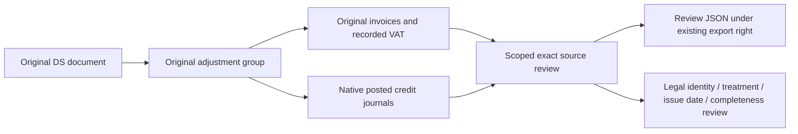

# Original credit document evidence and feedback ownership — build only

The original e-invoice source workbench now has a read-only credit-source path on the existing financial Discount details. It follows the original encrypted financial document identity/group and each native adjustment, invoice and unreversed Posted credit journal. It does not create a parallel credit ledger, replacement invoice, financial adjustment, tax number or transmission.

The source validates canonical metadata keys, native IDs, original invoice links and document number; all group lines are bounded and each original customer scope is checked. Gross/net/recorded-tax amounts and accounting dates come from the actual journals and their original invoice entries, not current item rates or a proposed TRN. Original gross/tax limits, exact inverse company-sale account entries, currency, reason and provenance are checked. Principal/third-party liability records are not turned into company-sale tax credits. Cancellation/BadDebt or mismatched metadata cannot masquerade as a Discount source.

The original multi-invoice financial document remains one DS number with separate original invoice references. Distinct currencies/parties require separate legal review. The native adjustment flow already rejects mixed customers before issuance; that guard was preserved when an initial test attempted an unsupported mixed-party fixture. A historical-shaped posted credit without the newer explicit original-journal/rate link remains readable as recorded evidence but carries an additional provenance-review blocker. No history is adopted or rewritten.

Legal credit number and legal issue date remain null: neither the accounting effective date nor record creation time silently supplies them. Legal identity, tax treatment, complete document coverage, official profile/rules and ASP onboarding remain explicit blockers; all approval/transmission flags are false. Ordinary users see human Arabic/English fields and recorded financial numbers; JSON source download requires the existing ledger export authority. No source file or personal profile blob is downloaded for review.

## Actual UI defect found and corrected

The new browser reproduced an existing shared network-feedback lease defect: a handler re-enabled its own valid button, then a later read reused an old lease which still said it did not own the disable. At zero active requests, the button could remain disabled. OperationUI now claims ownership only when it actually takes a currently enabled control. It preserves pre-disabled controls, a still-saving form, `control:false`, pending duplicate-click prevention and idempotent request completion. It does not authorize any action or replace server validation.

Three controlled-clock tests reproduce this behavior; the old source failed the re-enable case. The original real credit-source browser also reproduced the stuck control before the fix and then passed all three roles. Tests use real close controls. The stale-action probe uses native `HTMLElement.click`, which honors disabled state, and independently counts actual outbound requests and downloads; it never forces a disabled action or bypasses scope checks.

## Acceptance

- Six new native source cases passed: exact two-invoice gross31.500/tax1.500/net30.000; current-rate independence; whole-document original customer/company scopes and separate export authority; mismatched/cancellation/forged metadata refusal and no XML/approval escape fields; preserved original mixed-party rejection; genuine legacy-shaped posted evidence flagged for review; third-party liability refusal. Native financial tables and grants stay unchanged on all reads.
- Final40/40 native regressions passed across source credits, the prospective tax-source guard, original collection discounts/ledger, Owner-fronted disbursements, VAT workpaper and the existing invoice preparation archive.
- Actual source browser passed for Owner, reader and exporter, Arabic/English at1440/768/390, exact downloaded JSON, reader403, no inferred legal number/date, no new financial movement, and a held real export followed by switching company produced no download or new stale export request.
- Original invoice preparation browser passed, including immutable Owner-only technical versions and503 retry. Original financial package, customer save/timeout/lost-response recovery, customer workspace/private documents and customers with/without schema all passed after the shared feedback fix.
- TypeScript,175 static cases and portable build/module graph passed. Logs `/tmp/e64-*`. No combined cumulative count is claimed for this source until its immutable run is complete; the prior E61/E62 exact source passed586/586.

No original Supabase, migration, historical balance or grant change, real money movement, protected delivery action, staging merge or Render operation. This is source evidence and tested software; legal tax credit document issuance and all95 acceptance remain incomplete.

## Frozen combined source

Local `bf496c6dcf48fb090011e9b4587ac63b10243898`, exact tree `410ec5a09c954e9454defcc00f1c7bcfe33ced48`, including E63/E64/E65, passed **597/597**,0 failed/skipped,888931.000649ms on loopback5442. Tracked source remained unchanged throughout. Log `/tmp/financial-credit-source-cumulative.log`. This is build acceptance and does not authorize financial activation, filing or deployment.
