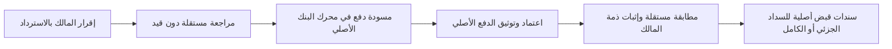

# E72 — الذمة الشخصية المستردة من المالك

بناء فقط؛ لم ينشر أو يطبق على قاعدة تشغيل. قرار المالك الصريح في22 نوفمبر2026: ذمة تسترد منه، مع مراجع مالي مستقل مخول. لا منح لصلاحيات أو إعادة تصنيف تاريخي.

يعاد استخدام سجل المطالبات غير البيعية، ودليل الحسابات والقيود والعمليات البنكية وسندات القبض القائمة. نوع الجهة هو المالك نفسه، وليس موظفاً أو جهة خارجية وهمية. يقر المالك بالمبلغ والشركة والمستند وموعد الاسترداد؛ يختار من المراجعين النشطين الحائزين بالفعل على الصلاحيات اللازمة للشركة. الاختيار لا يمنح صلاحية. لا يعتمد المالك ذمته ولا يستلم سداداً من نفسه.

الحفظ والمراجعة ومسودة الدفع لا تنشئ ذمة أو صرفاً. العملية البنكية الأصلية المعتمدة تقيد الدفع على أصل عبور مستقل. المطابقة المستقلة بعد الدفع فقط تنشئ مدين ذمة المالك ودائن حساب العبور؛ لا دفع أو مصروف ثانٍ، ولا فاتورة مبيعات أو VAT مفترضة. يجب مطابقة الشركة والمبلغ وهوية المالك ومرجع الطلب والمستند وتاريخ الإنشاء بعد المراجعة والقيد البنكي الفعلي. لا تستخدم حسابات البنك أو العهد أو ضريبة الرقابة أو المستثمر أو سلف الموظفين أو الحسابات المتبادلة للتجميع.

الاسترداد يستخدم سند القبض البنكي الأصلي دون قيد بنكي آخر، أو القبض النقدي وعهدة المحصل من المسار المحمي القائم. لا مقاصة تلقائية مع مستحقات بطاقة المالك أو العملاء أو المستثمرين أو الرواتب. يرفض الإلغاء العام لذمة المالك؛ التصحيح يحتاج مراجعة مستقلة لمصدر الدفع والتحصيل ولا يعكسه هذا العمل تلقائياً.

## القبول

-13/13 اختباراً مرتبطاً، منها أربع حالات جديدة، دون فشل أو تخطي: `/tmp/e72-owner-accepted-native.log`؛ يشمل100.001 ذمة،25.001 استرداد بنكي،75 نقداً، وصول الرصيد إلى صفر، ومنع اعتماد النفس والمصدر المغاير والتكرار وتغيير المدخلات.
-175 فحصاً ثابتاً، TypeScript والبناء ناجحة.
-واجهة فعلية AR/EN بثلاثة عروض شاشة، قوائم بأسماء بشرية، مسودة أصلية وربط الدفع، وفقد رد503 بعد نجاح الحفظ ثم استعادة النتيجة دون تكرار: `/tmp/e72-owner-accepted-browser.log`.
-لم يتغير أي منح أو قيد أو فاتورة قديمة. فحوص القبض استخدمت امتدادات الحماية المقترحة في قواعد اصطناعية معزولة فقط، دون تشغيلها سحابياً.

الطلب الشخصي الجديد يدعم مسار الدفع البنكي الأصلي الموثق؛ لم يتبن دفعات نقدية/شيكات شخصية قديمة، ولم يخترع سياسة تصحيح لها. جميع الحركات والوثائق والحسابات في الاختبارات اصطناعية، لا أموال أو خدمة بنك حقيقية. قبول جميع95 والنشر النهائي لم يكتمل.

## تحقق الحفظ والتوقيت

اكتشف فحص النسخة المجمعة أن ربط الواجهة اختبر في مساحة العمل ولم يضم إلىCommit E72 الأول. حفظ الربط في f22caa0، ودمج على مصدر100b3c8 في657c068؛ اجتازت الواجهة المجمعةOwner/source/GL/package فعلياً دون نشر. لا تنسب هذه الواجهة إلى4996948 وحده.

حد تاريخ مصدر الدفع يبدأ من يوم المراجعة بتوقيت الإمارات، بما في ذلك20:00UTC ونهاية السنة، وليس يومUTC السابق. اختبارات المسار والأيام5/5 ناجحة؛ لا تعديل لتواريخ سجلات قديمة.
