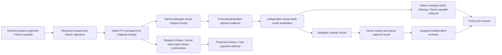

# Signed Owner settlement, outgoing cheque custody and separate closures — build only

The existing personal-card payments, balanced journal, native PV/cheque, private document archive, HR tasks and central work adapters are reused. No second accounting, task or approval system is introduced. This development branch is held from merge and Render delivery under `docs/finance/RELEASE-HOLD.md`.

A request reserves specific verified reimbursable card-payment splits in one authorized company. Its amount comes from those sources and its signed digest binds the Owner, sources, amount, company and approved personal destination suffix. The Owner personally approves and supplies clean signature evidence. No new expense, customer collection or bank movement occurs when requesting, signing, preparing or approving a cheque.

The source creates an idempotent native PV payable to the Owner against the already-recognized Owner liability. Ordinary payment/adjustment endpoints cannot bypass the signed workflow for these freshly designated payables. The native cheque's company, bank, beneficiary, currency and amount must match. Actual bank clearing reduces the original Owner liability once, after independent deposit verification and a sufficient payable balance. Personal bank destinations are not registered as company-owned bank accounts: the approved suffix and signed evidence are checked by the financial verifier; a suffix alone does not prove account ownership or bank credit.

The Owner chooses an active, linked and authorized HR delegate by name. The original native task asks that actual employee to confirm receipt of the physical cheque and its exact amount. Only that delegate can submit the subsequent personal-destination deposit evidence. The submission remains unverified and the employee's clearance remains blocked. An independent authorized financial verifier must confirm the exact amount/destination and actual bank credit or authorized bank confirmation. A picture alone is insufficient. Source reference and content-hash reservations prevent duplicate deposit proof use. Verification closes cheque custody but does not pretend that company-bank clearing has already occurred.

The Owner's actual payment to the personal card issuer is a separate administrative proof, allocated against the actual bank-payment amount. Cross-request allocations cannot exceed the original payment; reused content under another reference is blocked. The Owner explicitly assigns an active independent reviewer with existing financial verification/document rights. Neither the Owner nor any current or previous cheque delegate can verify that repayment. Returned reviews retain their history; a correction starts another review round, safely releases the superseded allocation and never creates another company expense/payment. Company accounting closure and verified personal-card repayment are displayed separately; final closure requires both plus verified delegate deposit.

Stopped cheques cannot proceed through receipt, deposit approval or reissue. The delegate records the physical return and the Owner independently confirms receipt of the stopped original. Until confirmation, employee clearance and replacement remain blocked. A replacement preserves the prior custody/deposit and native voucher history, starts a distinct payment attempt and uses distinct native source-task keys. Cancelling a returned request releases its reservations with an audit reason; it never waives the original Owner debt. Generic HR reassignment/delegation cannot silently transfer physical cheque responsibility. A dedicated transfer between delegates remains pending; documented stopped-cheque return and reissue is the supported safe correction route.

Work is projected from a minimal source index without decrypting every personal source record or creating extra task copies. Actual native preparation/approval/clearing and each reviewer round remain in completed work history. The existing HR receipt/deposit tasks continue to represent the physical delegate actions. The dashboard, task center and financial register open the same source actions. Archive queries use the bank scope for a bank-authorized reviewer, without granting broader company-document rights. Uploads use the existing archive, preserve the version on failure/quarantine, and reuse a stable idempotency key per file hash.

Acceptance is recorded in the master checklist and BUILD-STATE after tests finish. All fixtures are randomly isolated local PostgreSQL databases and fake providers; no source Supabase writes, live money movements, historical balance migrations, role changes or delivery requests occur. This bundle does not complete all 95 requirements: wallet consumption, unbilled/adjusted customer cases, exceptional personal requests, tax decisions and other master-checklist gaps remain.

Verified locally: 13 related native financial/task tests, 172 static regressions, TypeScript and portable runtime build; the three-actor complete browser passed AR/EN at 1440/768/390px, retained a rejected 49 AED receipt input before the valid 50 AED receipt and kept the existing customer invoice 450 AED outstanding. Three cold browser contexts share one loopback IP, so the test respects the unchanged one-minute request window before opening the reviewer session. Cumulative backend regression is separately tracked; no claim of complete 95-requirement acceptance is made.

Cumulative baseline verification completed: `npm run backend:test` passed 461 tests, zero failures (472 seconds). This is regression evidence for the implemented baseline, not acceptance of the unimplemented master-checklist requirements.
