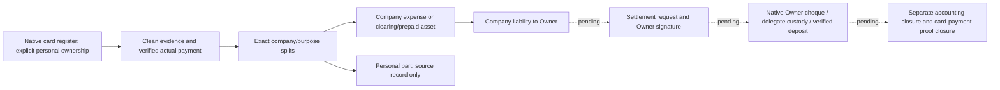

# Personal Owner card — native accounting foundation, build only

The original cards, charges, splits, statement matching, private evidence and balanced journal engine are reused. New cards can be explicitly designated `personal_owner`; historical company cards are not reclassified. Creation requires the active Owner and an active Owner holder, AED and a dedicated Owner-payable liability definition. That definition cannot be used by ordinary financial items or a company card. The bookkeeping company is a scope for the register, not a declaration that the company owns the card or its issuing bank account. No company bank is created.

Verified actual payments require clean evidence, exact split totals, explicit classifications, Owner review and a tax-review basis. Each beneficiary company recognizes its own debt to the Owner directly, rather than debt to another group company or to the personal card issuer:

- Business expense: existing approved expense mapping / Owner payable.
- Customer disbursement: only an existing matching unadjusted pass-through invoice, debit its liability clearing account / Owner payable. Customer AR and receipts remain unchanged. Unbilled, partly adjusted or unresolved mappings are blocked for separate review.
- Wallet top-up: a separately reviewed dedicated prepaid asset / Owner payable. No consumption expense or vehicle invoice is created by topping up. Customer/staff receivables, cash funds, custody and reciprocal accounts are excluded from wallet registration. Full wallet consumption attribution remains pending.
- Personal spending in the statement: retained in original source detail but excluded from company journals and Owner reimbursement. Office payments on exceptional personal requests remain a separate pending requirement.

New personal card source details/statements are Owner-only at this stage; existing company-card permissions are unchanged. Ordinary authorized company-ledger reports still expose each company's own posted expense/payable. Workbench/register exports and card reports exclude personal source records for non-Owners. No permissions are granted from job titles or changed automatically. The native commercial-card statement-to-issuer-PV workflow explicitly rejects personal cards; Owner reimbursement must use its future signed settlement/custody path.

The Owner payable view distinguishes gross payments attributed to this card, excluded personal amounts, and the actual signed balance from the dedicated Owner ledger. A shared payable may include another personal card, so attribution is not presented as another receivable or a second outstanding balance. No customer collection is inferred.

Acceptance: mixed payment across two companies posts exact Owner payables (35 and 3 AED in the synthetic case), 10/3 business expenses and a 20 AED wallet asset, excludes 2 AED personal spending, leaves the customer's 5 AED invoice outstanding, creates no company bank/receipt, prevents reused customer invoices, rolls back all split journals on error, and denies personal source access to ordinary finance users. The existing statement match/approve functions work, while issuer-PV creation is blocked. Dedicated wallet setup, personal creation, manual purpose selection, actual-payment review and Owner-ledger drilldown passed the real AR/EN browser at desktop/tablet/mobile sizes. 53 combined native financial tests passed. Full cumulative regression/CI and final package acceptance remain required.

Pending: full Owner request/signature/reimbursement, delegate cheque custody, personal-account deposit verification, bank-clearing correlation, proof of personal-card repayment, independent accounting/administrative closure, unbilled/adjusted customer cases, full wallet consumption and exceptional personal company payments. This foundation is not completion of phase 7 or of the 95 requirements. No live financial operations, schema migrations, historical balances, original Supabase data, user permissions or deployment were changed.

Follow-up: the signed settlement, native cheque, delegate deposit and dual closure gaps above are now implemented and tested in the build branch; see [Owner settlement bundle](owner-settlements-2026-11-21.md). The remaining customer, wallet and exceptional-personal gaps still apply.
