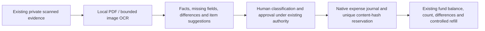

# Petty-cash evidence extraction — build only

The existing fund, native cash expense journal, private document archive, local bounded PDF parser and isolated image-OCR worker are reused. No new fund, historical opening balance, permission or live transaction is created by this feature.

The authorized fund holder/manager can select a scanned private document in the original expense form and request an advisory review. Explicit labelled totals, supplier, date, invoice reference, TRN and printed tax amount are extracted when available. Arabic/Persian digits and exact thousandths are normalized. Multiple conflicting amounts remain ambiguous; unlabeled values are not guessed. Matching an existing allowed expense-item name may suggest that item, but it never changes the selected item or asserts tax treatment/deductibility. Images use the existing local resource/time bounds and low-confidence results require manual review. PDFs with text layers are parsed locally. No external AI/financial provider call is introduced.

The review has no financial effect, never approves expenditure and never creates a VAT claim. Missing/ambiguous fields and differences from the proposed expense are shown for supervisor review. Current delegated manual authorization remains authoritative; a separate automated supervisor routing/approval policy is not invented. Requirement 8.6 remains partial.

Actual native spending with a supplied document now requires clean, accessible evidence and atomically reserves its content hash per company. Reuploading identical bytes under a new filename/document cannot create a second expense. Historical expenses are not automatically indexed or reclassified; duplicate coverage is explicitly prospective. Different scans/references and files legitimately containing several receipts still require review rather than guessed deduplication. Legacy API spending without a supplied document is retained for compatibility; the improved UI requests the archived evidence.

Acceptance: 52 combined native financial tests passed, including actual local PDF extraction, exact tax/total fields, advisory-only behavior, existing-item suggestion, discrepancy detection, unauthorized access and duplicate copied evidence. Independent browser acceptance passed PDF review, unchanged manual selection, native cash spending and AR/EN desktop/tablet/mobile views. Existing image OCR/receivables-cycle regressions also passed. 172 static checks and portable runtime/type checks are required on the cumulative head. This is not full tax or petty-cash automation acceptance.

