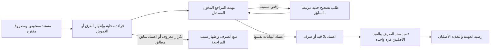

# المراجعة المستقلة لمستندات النثريات — بناء فقط

امتداد للعهد والمصروفات وسندات الصرف ومركز المهام الأصلي. لا مخطط جديد ولا قاعدة صلاحيات جديدة ولا تفعيل تلقائي على العهد الحالية.

## الضوابط

- يحدد المالك مراجعاً نشطاً من الموظفين ذوي الصلاحيات الحالية في الشركة، مستقلاً عن حامل العهدة ومقدم الطلب. لا يُمنح أي حق بناء على المسمى الوظيفي.
- إعداد مستقبلي لكل عهدة؛ تغيير المراجع الافتراضي لا يعيد إسناد طلبات سابقة أو يعيد احتساب مصروفات.
- إعادة إسناد معلقة بإجراء موثق من المالك، على المهمة الأصلية مع حفظ المسؤول الأول وسجل التحويل. المراجع السابق لا يعتمدها بعد نقلها.
- الاعتماد يطابق البند والمبلغ والتاريخ والسبب ونسخة المستند وبصمته. تعديلها لا يصرف اعتماداً مختلفاً؛ الخطأ يحتفظ بالمدخلات.
- قبول المراجعة يغلق مهمتها فقط، دون قيد أو PV أو تخفيض نقدي. التنفيذ يستخدم محرك الصرف الأصلي ويستهلك الاعتماد مرة واحدة، حتى عند إعادة الإرسال بمفتاح مختلف.
- بصمة الملف تمنع إعادة صرفه. تطابق المورد ومرجع المستند وتاريخه في نفس الشركة يكشف إعادة مسح الفاتورة ببايتات مختلفة، عبر فهرس تجزئة محدود لا يحمل أسماء مكشوفة. اعتماد/صرف سابق مطابق يمنع اعتماداً ثانياً؛ الغموض لا يتحول إلى تصنيف آلي.
- الرفض والتصحيح لا يحذفان الطلب أو المهمة أو الدليل السابق. لا تُفترض قابلية استرداد VAT أو حسم المصروف ضريبياً من الصورة.
- الملفات تُحمّل عند فتح المستند فقط، من مسار الفحص والصلاحيات الأصلي. لا Polling أو تنزيل أرشيف المستندات لأجل هذه الشاشة.

## القبول

26 اختبار خادم مرتبط ناجح، ثم الحالة الموسعة نفسها ناجحة بعد إضافة الرفض والتصحيح، والمراجع البديل، وإعادة مسح فاتورة واحدة في عهدتين مختلفتين. تشمل اختبارات الأستاذ وسند الصرف الأصلي، وعدم إنشاء فاتورة عميل، وثبات الصلاحيات، وعدم إنشاء قيد عند المراجعة، ومنع الإعادة والتكرار والمراجع غير المخول.

متصفح فعلي ناجح: إعداد المراجع، إرسال من شاشة العهدة، فتح الصف في المهام، معاينة PDF المفحوص، قرار مستقل، رفض مبلغ تغير مع حفظه في النموذج، ثم سند أصلي واحد. العربية والإنجليزية وثلاثة مقاسات ناجحة. واجهة النثريات السابقة نجحت أيضاً. 172 فحصاً ثابتاً وTypeScript والبناء المحمول ناجحة.

القبول التراكمي السابق **497 ناجحاً** يخص نقطة `d55bc80` قبل هذه الإضافة؛ سيعاد على الحزمة المحفوظة الجديدة. لا نشر أو كتابة على Supabase.

## الحدود

الفهرسة مستقبلية؛ لا تدعي كشف كل مستند تاريخي أو OCR غير مقروء. التصحيح المالي أو رد مصروف مسجل يستخدم إجراءه الأصلي، ولا يلغي تكرار المرجع بإخفاء السند السابق. تفعيل إعداد العهدة واختيار الموظف الفعلي قرار إعداد صريح، وليس تغييراً تلقائياً لصلاحياته أو لرصيد قائم.

الكود: `backend/src/petty-expense-approval.ts`، الواجهة `petty-review-ui.js`، الاختبار `backend/tests/petty-expense-approval.test.ts` والمتصفح الموافق. أضيف الملف صراحة لقائمتي الأصول الثابتة الأصليتين؛ لم توسع صلاحيات الملفات أو البيانات.
