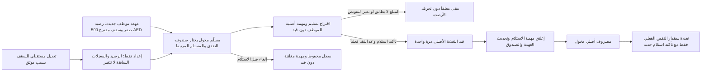

# العهدة النثرية: تسليم فعلي وسقف قابل للتعديل — بناء فقط

## الاستخدام وإعادة الاستخدام

الصناديق والحسابات وسجل الموظف والمهام وقيود التغذية الأصلية هي المصدر الوحيد. استُخرجت عملية التحويل نفسها إلى `fund-refill-domain.ts`، ويستعملها المسار الأصلي ومسار التسليم الموثق. لا جدول مالي أو نظام مهام موازٍ، ولا فاتورة عميل أو RV أو مصروف من نقل النقد بين الصناديق.

- سقف العهدة الجديدة 500 AED قابل للتعديل؛ لا يفترض النظام وجود 500 نقداً عند إنشاء سجل الموظف أو الصندوق.
- العهدة الجديدة الصفرية بعملة AED لموظف آخر تتطلب استلامه قبل أول تغذية. الصناديق الموجودة لا تعاد تهيئتها أو تصنيفها. استخدام مسار التسليم لاحقاً يسجل اشتراط التأكيد للعمليات المستقبلية في تلك العهدة صراحة.
- المسلّم يحمل الصندوق النقدي فعلياً، وله صلاحية إدارة الصناديق الحالية في الشركة. المستلم موظف نشط مرتبط بالعهدة ومخول بالعرض والاستلام. لا يستنتج أي تفويض من المسمى الوظيفي ولا تُضاف منح للمستخدمين. المدير المخول يستطيع الإجراء بصلاحياته القائمة؛ لا دور جديد أو اشتراط مسمى المالك.
- الاقتراح لا يغير النقد أو عهدة الموظف ولا ينشئ قيداً. المسؤولية تبقى على المسلّم حتى التأكيد الفعلي. مبلغ مختلف يُظهر خطأ الحقل والمرجع ويبقى الطلب معلقاً؛ لا تُثبت قيمة غير مؤكدة أو يستقطع الفرق من الراتب.
- تأكيد الموظف وحده يستخدم مبلغ الطلب والتاريخ الحالي الصحيح، ويعيد التحقق من الهوية والتكليف وحالة الصندوقين والتفويض والرصيد. اختلاف الشركة أو العملة أو المصدر غير النشط يمنع النقل.
- معرف إعداد ثابت، ومعرف تأكيد ثابت، ومراجعة متوقعة يمنعون تكرار الإعداد والتحويل. إعادة التأكيد المتزامنة تعيد القيد الأصلي نفسه. لا تتغير ذمم العملاء أو أموال المستثمرين.
- المهمة الأصلية تُغلق بعد التحويل فقط. لا يجوز تغيير المستلم عبر إعادة إسناد مهمة عادية، أو اعتبار المهمة منجزة بدلاً من استلام الأموال. إلغاء المقترح يغلق المهمة دون احتسابه استلاماً فعلياً.
- سجل التسليم يفتح السجل الأصلي بالنقر على الصف، مع منع نافذة التفاصيل العامة المكررة. بعد نجاح الاستلام يُغلق العرض المعلق فوراً، وتحدث المهام ثم يعرض السجل المحفوظ؛ فشل تحديث قائمة لاحقة لا يُعرض كفشل مالي أو يعيد التحويل.
- تقرير إخلاء الطرف الأصلي يرى رصيد العهدة الفعلي ويمنع إخلاء طرف موظف ما زال يحمل 500. لا نسخة من الأرصدة في النظام الجديد.

## السقف والأرصدة

تعديل السقف وحد التنبيه إجراء إعداد مخول، موثق بالقيمة السابقة والجديدة والسبب والمراجعة. يمنع التعديل أثناء تسليم معلق، ويرفض سقفاً دون النقد المحمول، ولا يسمح بتعديل إعداد قديم باستعمال مراجعة متقادمة. تغيير 500 إلى 700 لا يزيد الرصيد 500؛ يعرض فقط حاجة جديدة إلى تسليم 200 وتأكيد استلامه. سجلات الاستلام القديمة تبقى 500 ولا يعاد احتسابها.

تغذية نقص ناتج عن مصروف 50 تعيد 50 فقط، ولا تسجل المصروف مرة ثانية. المصروفات والتحقق من المستندات والمراجعة المستقلة والجرد والتسوية تظل في مساراتها الأصلية. تسليم العهدة لا يمنح صلاحية اعتماد مصروف أو معاملة ضريبية.

## القبول

- 33 اختبار خادم مرتبط ناجح، تشمل الأستاذ والنثريات والمراجعة المستقلة والسلف.
- 3 حالات موسعة ناجحة على الكود المجمد: انتظار أول 500، منع التغذية المباشرة، رفض 499 دون قيد، الاستلام المتزامن مرة واحدة، نقص 50 وتغذية 50، إلغاء مع حفظ السجل، إخلاء الطرف، المنح القائمة لمدير مخول ورفض موظف آخر، ورفض صندوق مصدر غير نشط. تشمل أيضاً تعديل السقف 500 إلى 700 دون قيد ثم تسليم الفرق 200؛ المصروف يبقى 50 فقط، والتحويلات تحفظ التوازن.
- متصفح فعلي ناجح: أسماء موظفين حقيقية ضمن بيانات الاختبار، مصدر محدد، مهمة الموظف، رسالة الحقل ومرجعها مع بقاء 499، نجاح 500 وتحديث المصدر والعهدة والسجل، فتح سجل واحد فقط، العربية والإنجليزية وثلاثة مقاسات. اختبار تعديل السقف في الواجهة يرفض 100 دون محو الرصيد ثم يقبل 700 دون قيد أو إعادة كتابة استلام 500.
- TypeScript و172 فحصاً ثابتاً والبناء المحمول ناجحة. القبول التراكمي السابق **506/506** يخص حزمة مطابقة سداد البطاقة المحفوظة `b21ab36`/الشجرة `86c36e6349e0220bd9a35263c0a98a16501b1aee`؛ لا ينسب تلقائياً لهذه الإضافة.

## الحدود والحماية

هذا تسليم العهدة النثرية المحددة بالكامل؛ تسليمات التحصيل الجزئية وفروقها تبقى على مسار العهد والتحصيل الأصلي ولا تُستبدل. إذا تغير الرصيد أو التفويض أثناء انتظار التسليم، يتوقف الإجراء للمراجعة ولا ينشئ نقداً لتغطية الفرق. سجل الواجهة يعرض أحدث 100 تسليم مع تنبيه واضح عند وجود المزيد؛ الأستاذ والتقارير الأصلية يحتفظان بجميع القيود. يبقى سجل العهدة المؤرشفة قابلاً للقراءة وفق الصلاحية، مع منع أي تسليم أو تعديل سقف جديد عليها.

لا ترحيل أو Reset أو Restore أو طلب نشر أو تعديل بيانات Supabase أو صلاحيات تشغيل. الاختبارات في PostgreSQL محلي ومصادقة وتخزين وهميين، دون حركة نقدية حقيقية.
