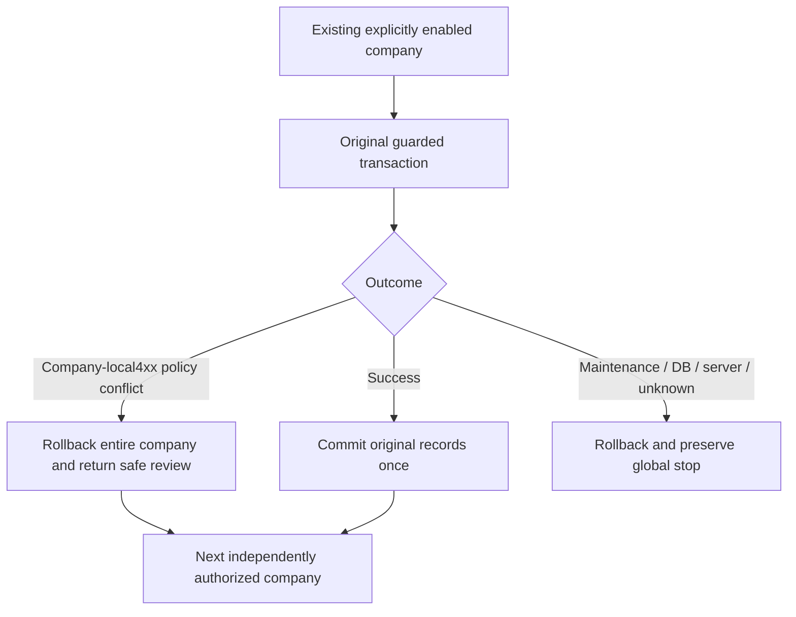

# E80 — Isolate company-local scheduled policy failures, preserve global stops

Build only. No hosted activation, schedule, registry row, financial policy, rate, grant, source data, Reset/Restore or schema change. Both original same-service workers remain opt-in/default-off and retain their existing cadence, actor and enabled-company registries.

Root cause from code: each original worker awaited one transaction per company inside a loop, but had only the outer startup catch. An exception in one company's policy/mapping/source checks aborted that loop, so later independently approved companies were not processed. No evidence is claimed that this happened on live data.

Both existing workers now roll back a failed company's whole transaction and continue only for explicit application policy/authorization conflicts (ApiError4xx). They return a structured company review, not a false success. Unknown messages/SQL are never copied into it. Safe logging selects company, stable review code, approved reason code and status only. The same configured relationship/source keys handle a later normal tick; no random retry, repair, fallback account, grant or automatic approval.

Global maintenance503, server5xx, PostgreSQL errors including53100, connection/commit failures and other unknown exceptions still throw and stop further processing. The original transaction maintenance checks and shared advisory guard are untouched. An earlier successfully committed independent company's transaction is not represented as rolled back by a later global failure.

14/14 related native tests passed, including5new cases, then5/5 final privacy/failure-boundary cases passed. Actual local PostgreSQL verifies a bad mapping holds only its company; a fault after a real invoice/journal write leaves no partial document/link/journal; the next company commits once and a subsequent repair/retry does not duplicate it. The vehicle worker has the same rollback/continuation proof, preserving its legacy calendar policy. Global maintenance and53100 stop before later jobs. Logs omit injected secret/error/SQL fields. Existing explicit relation company separation, December idempotence, service audit identity and release guards pass.175/175 static checks, TypeScript and provider-free build passed.

Logs:`/tmp/e80-scheduled-isolation-final.log`,`/tmp/e80-scheduled-isolation-privacy.log`,`/tmp/e80-scheduled-isolation-final-{type,static,build}.log`. No browser test is added because no UI or API form changed. A new combined full-suite run remains separate acceptance; this is not all95 or financial activation approval.

This does not adopt legacy contracts into monthly-only fees, change investor agreements or enable new fees. Those keep their existing explicit policy and final release/activation gates.
