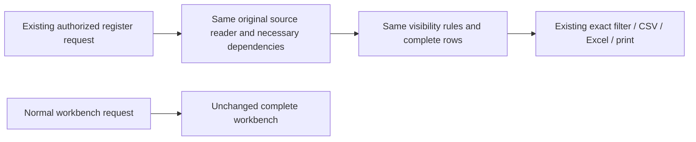

# E82 — Read only the original ledger source requested by a register

Build only. No hosted query, migration, data/grant change, caching, polling, provider call or financial computation added.

`/api/ledger/register-view` previously rebuilt the complete original ledger workbench before extracting one requested source. That loaded/decrypted unrelated journals, vouchers, cards, deposits and other tables on filter/print/export requests.

The same original `ledgerWorkbench` now accepts an internal validated source selection. It retains the same row preparation, limits, card ownership/visibility, own/audited custody and deposits, fund scope, names and existing register filtering/export. Statement views retain their card-name dependencies. Invoice registers call their existing original invoice reader directly. The ordinary full workbench endpoint and its complete shape remain unchanged. No source authorization, column, company, report/export or global transaction guard is skipped.

A real isolated PostgreSQL measurement of this helper read13 generic ledger tables for the full workbench and1 for the requested voucher register. Supporting authenticated-model/context reads remain separate. This is a query-count measurement, not a measured Egress/billing saving or evidence that AB Group caused the earlier organization-wide usage spike.

7/7 related native tests passed (3new), including selected-field/row parity across17 original sources, four output formats and Owner/scoped reader; private Owner cards/charges/statements, own funds/deposits/transfers, complete output beyond old200/500 limits, foreign-company/export denial, unchanged entries/receipts/grants and13→1 helper scan count. An intentionally corrupt synthetic Draft journal still fails its own source and the full workbench closed; it does not block an unrelated valid voucher source. The original corruption response remains422. No automatic data repair or relaxed decryption guard.

Test setup uses the original custody routes and acknowledged handovers before a pending deposit, and distinct company/personal card input formats; existing `depositPending`, handover and `personalCardRequired` guards were preserved. These fixture corrections are not reported as live incidents.

Actual complete-dashboard, original Pending/Review drilldown and original financial-package browsers passed on the changed reader, including AR/EN, scoped empty/private results, complete print and original document workflows.175/175 static checks, TypeScript and provider-free build passed. Logs:`/tmp/e82-register-read-scope.log`,`/tmp/e82-register-browser-regressions.log`,`/tmp/e82-register-read-final-{type,static,build}.log`. A later combined659 native run remains separate acceptance.

Seven completed own synthetic test logs were compressed losslessly to ease temporary workspace pressure. Decompressed SHA256 values were verified before removing their redundant uncompressed copies. No project/data/attachment/backup file or active test log was included. See `docs/finance/TEST-LOG-ARCHIVES-20261122.json` for exact original/archive paths, byte counts and checksums; use gzip to read the original bytes. No logs or backups are committed. Only this metadata is versioned.

No staging merge/delivery or protected workflow action. All95 acceptance, tax policy and final release gates remain separate.
