# Shared obligation settlement through original bank operations — build only

This extends the original supplier obligation and original bank approval engine. It creates no company, role, financial table, second expense system, customer invoice, VAT determination or automatic hosted activation.

```mermaid
flowchart LR
 A[Original shared accrual and matched reciprocal accounts] --> B[Actual supplier payment verified]
 B --> C[Specific future financial approval for both companies]
 C --> D[Beneficiary bank payment draft]
 D --> E[Original bank approval with matching actual reference]
 E --> F[Reduce original beneficiary liability]
 F --> G[Actual matching receipt evidence at supplier payer]
 G --> H[Original payer bank receipt draft and separate approval]
 H --> I[Reduce original payer receivable]
```

## Source and accounting controls

- The share, three-decimal amount and reciprocal accounts come from the original approved commitment and its original posted/unreversed journals. Several shares sharing one payer account are reconciled to that original account's complete allocation; no equal-amount guessing.
- Original supplier payment must actually be posted. A cheque voucher's `Paid` flag alone is insufficient: the approved native operation, payable counterpart and exact posted amount must match. Cash/direct-bank paths reuse the original payment projection.
- Separate company/bank/document permissions and original intercompany/view/settle rights apply. No grants are added. Native bank approvers still require their existing `finance_approve`; receiving-side approval is independent of a draft or payout-side approval. Ordinary source-only readers never receive settlement bank metadata in the general commitment register.
- New settlement creation and outgoing bank approval require the existing specific financial feature approval `shared_settlements` for **both** companies. This build adds no activation API or approval record on hosted data. A previously approved outgoing movement may finish its evidenced receiving side after prospective activation is stopped; stopping future activity cannot erase the actual payout.
- Only selected active AED bank accounts of the relevant company are accepted. Existing custody, customer credit, cheque transit, employee advance, wallet, investor monthly, Owner card and VAT control safeguards remain in force. No new VAT or expense is posted.
- Original source journals and original linked settlement movements are reconciled in a bounded batched source read. An unlinked manual/legacy account movement requires financial review; it is never silently assigned to a share, reversed, migrated or classified from its amount. This conservative review may block an otherwise valid mixed historical control account until its sources are reviewed.

## Atomicity and history

The original API transaction creates a native bank draft and saves its immutable source link on the original encrypted commitment together. Exact concurrent/manual retries recover the same source link; changed duplicate data, borrowed references and over-reservation fail closed. Original approval posts each bank operation once, verifies its source before and after posting, and records its audit on the original commitment. A draft is not payment; an approved payout is not receiving-company receipt. No promise/image alone settles the reciprocal receivable.

Partial payments are separate linked rows. Rejected outgoing drafts release their reservation; replacement receipts retain prior rejected operation IDs. Approved movements are not deleted or cancelled through this extension. Parent commitment cancellation refuses active/paid settlements and keeps the original paid-supplier correction guard. Corrections after an actual approved payment remain governed by the existing authorized correction process.

Each selected payment row's receiving amount must match that actual payout in full; a different receipt amount requires reviewed handling rather than inventing a variance entry. Further partial payouts can use separate rows. This does not establish bank statement reconciliation merely from uploading an image or entering a reference.

## Interface and acceptance

The original commitment table opens a share review in the existing floating record/form system. It shows original share, draft reservation availability, approved payout, approved receipt, in-transit amount and each remaining side separately. Authorized actions create original bank drafts or use original bank approval, with scanned source documents and company bank names. Success refreshes the original screen/review; failures retain form inputs/reference; company/actor changes cannot apply a stale form.

- Fifteen targeted native cases passed across the new settlement, original shared commitment and supplier payment suites; original banking/ledger regressions separately passed29 cases.
- Final five new cases passed after bank/control-role hardening: exact partial two-sided settlement; no second expense/VAT/customer invoice; parallel duplicate and over-reservation; unpaid supplier; specific activation; wrong company bank/document; unconfirmed/forged movement; rejected replacement history; prospective stop after actual payout; private metadata and separate original approval rights; unlinked manual account movement refuses attribution.
- Real new browser acceptance passed: Owner actions and source-only reader, AR/EN at1440/768/390, partial actual payout and receipt, refreshed states, and a503 **after actual server commit** followed by manual retry recovering the same ID. Original expense journals/invoices/effective rights remain unchanged. Final reruns of the new browser, original financial package browser and original supplier cash/bank browser all passed.
- Final TypeScript,172 static tests and portable build/module graph all passed; final verification logs use `/workspace/ab-test-tmp/shared-settlement-*`.

Requirement4.4 remains **partial** because approved VAT/recoverability/recharge scenarios and final financial activation are not assumed. All95 remain incomplete. No hosted database write, historical change, migration, Reset/Restore, merge, delivery request, protected run change or Render operation was performed.

Frozen complete acceptance: **573/573 native passed**,0 failed/skipped,873168ms, local `e7c317331af4bb6060364f7f7285dd1693d8fe8b`, exact tree `c636a3adfd065c43cb9f9ae38d72428fcdae65e1`. Saved remotely without merge/deploy at `052c9a0f5f62a4008640295747fab24041d8536d` in draftPR115. Log `/workspace/ab-test-tmp/financial-shared-settlement-cumulative.log`; no tracked edits during the run.
