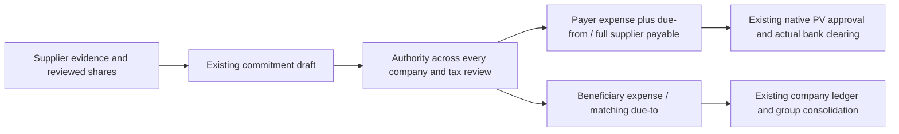

# Shared supplier obligations — build-only extension

The original commitment/request/native-PV workflow is extended, not replaced. The supplier payable remains entirely with the paying company. Explicit positive beneficiary shares must total no more than the supplier obligation; the residual is the payer's expense. Each beneficiary company receives its own expense and due-to-payer liability; the payer receives matching due-from assets. Reciprocal accounts must be explicitly configured for consolidation elimination. All amounts use integer thousandths; no floating-point allocation, income creation or customer sales invoice.

Creation has no financial effect. Independent company scope/intercompany permissions are checked for every share both on creation and accrual. Native journal creation and record update occur in one original API transaction; repeated approval cannot duplicate the shares. Payment settles the original supplier payable once, without expensing the total again. Voucher validation checks that all related accrual journals remain posted and unreversed. Cancellation before payment requires cancellation of any linked PV and reverses every company journal in the same transaction, preserving history. A paid supplier obligation cannot be erased through this workflow.

The AR/EN UI uses authorized company/item/account names, optional per-company shares and an explicit no-VAT review basis. Approval discloses the supplier total, payer residual and beneficiary amounts. Current implementation accepts only evidence explicitly reviewed as having no VAT, with zero-tax item mappings. It does not decide recoverability, generate a tax claim, recharge VAT, or automatically classify an uncertain supply. Requirement 4.4 remains partial until approved VAT scenarios and full settlement/reconciliation acceptance are complete. Intercompany debt settlement remains an independent, controlled financial process; the supplier payment does not automatically settle reciprocal company debts.

Acceptance: 37 targeted native ledger/import/commitment/advance/template tests passed, plus group-consolidation acceptance; standalone shared-expense browser passed named selectors, exact shares, financial-impact confirmation, native approval and AR/EN 1440/768/390 layouts. 172 static regressions and TypeScript/portable build passed. Cash, supplier and bank actions in tests are synthetic loopback only, using fake providers. No live balances, permissions, migrations, deployments or existing workflow runs were changed.
