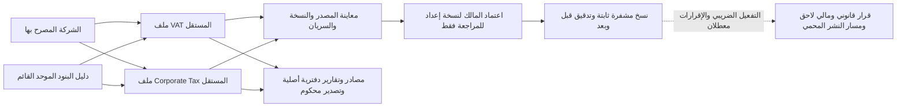

# E90 — مركز التحكم الضريبي المستقل لكل شركة

بناء ضمن PR115 فقط. لا نشر أو استعلام/كتابة على Supabase الأصلي، ولا تعديل صلاحية أو قيد أو فاتورة تاريخية أو تقديم إقرار. هوية الواجهة الحالية محفوظة؛ الصورة مرجع توزيع فقط، ولم تُنسخ نسبها أو شركاتها أو TRN كبيانات تشغيل.

## مطابقة التصميم المعتمد

| المتطلب | التنفيذ |
|---|---|
|1–3 المركز والشركة والملفان|تبويب الضرائب القائم أصبح مركز التحكم. اختيار الشركة من محدد الإدارة المالية القائم؛ VAT وCorporate Tax ملفان مستقلان.|
|4 الإعدادات المستقلة|نسب VAT وحد التسجيل وحالة التسجيل المقترحة، وحد خاص وشرائح ضريبة الشركات، وفترات وسريان ومرجع وملاحظات مستقلة. لا نسب أو حدود قانونية افتراضية.|
|5–6 دليل واحد وتصنيفان للبند|قراءة `finance_items` الأصلية، بما فيها البنود العامة غير المخصصة لشركة والبنود غير النشطة المحفوظة. نفس itemId يمكن تصنيفه بصورة مختلفة في الملفين؛ لا CRUD لدليل ضريبي موازٍ.|
|7 الجدول|اختيار بنود، فتح الصف للتصنيف، تصنيف جماعي للمحدد، بحث وفلترة وترتيب ومخرجات كاملة. شرائح CT في إعدادها؛ لا نسبة VAT فارغة مضللة في صفوف CT.|
|8 الحالة القانونية|بانتظار مراجعة/مصنف/غير خاضع وفق مرجع قاعدة؛ المرجع إلزامي للحالتين المحسومتين في المقترح. الاختيار يحدد نطاق المراجعة فقط، ولا يحول غير المحدد إلى إعفاء.|
|9 VAT|نوع التوريد ونسبته واسترداد مدخلات مقترح مستقل. مثال شركة مسجلة ومبلغ أقل من حد التسجيل لا يصبح معفى؛ حد التسجيل منفصل عن ضريبة التوريد، وليس قرار تسجيل قانونياً.|
|10 ضريبة الشركات|إيراد/مصروف/استرداد رأس مال/ذمم/تعديل ضريبي، ومعالجة مقترحة متوافقة. أساس المثال الربح المحاسبي والإضافات والاستبعادات، وليس المقبوضات. تقارير الربح الأصلية معاد استخدامها.|
|11 المعاينة والتاريخ|معاينة مرتبطة بالمستخدم والشركة والنوع ونسخة الدليل وبصمة HMAC وصلاحية15 دقيقة. المالك يعتمد نسخة إعداد للمراجعة فقط بتاريخ سريان مستقبلي؛ نسخة وأسماء بنود محفوظة وتدقيق قبل/بعد، دون تعديل الأصل.|
|12 الواجهة|AR/EN وRTL/LTR والهوية والحقول والمكونات القائمة، واختبار1440/768/390. لا صفحات منفصلة أو دليل حسابات/بنود جديد.|
|13 لا تفعيل أو إقرارات|`automaticTaxPosting`, `filingReady`, `submissionEnabled`, `taxTreatmentLegallyApproved` تبقىfalse. `taxDue` يبقىnull حتى عند عرض مثال حسابي مقترح. لا موصل مزود أو تنفيذ دفع أو قيد.|
|14 استكمال الحزمة|فرع البناء ومسودة115 فقط؛ مسار النشر والبوابات والأعمال القائمة لم تعدل.|

## مصدر واحد دون فقدان المسودات السابقة

الإعدادان الجديدان نسخ داخل namespace الأعمال المالية القائم `ledger:tax-control-profile-v1:<company>:<type>` فيsettings المشفرة، مع صلاحيات RLS والتدقيق الحالية؛ لا ترحيل أو جدول أو دور جديد. نسخ البنود المحفوظة أدلة تدقيق بأسمائها وقت النسخة، وليست دليل بنود آخر.

المسودة السابقة `tax-preparation-v1` تبقى محفوظة وقابلة للقراءة في قسم اختياري للمقترحات السابقة والمصادر الدفترية. عند إنشاء ملف مستقل، يصبح وحده مصدر التصنيف والفترات الحالية؛ API القديم يرفض تعديل خرائط/فترات ذلك النوع. تظل هوية الشركة وحسابات رقابة VAT وتسويات CT المقترحة الأصلية في وظائفها القائمة. لا نسخ تلقائي أو اعتماد أو إعادة تصنيف تاريخية. مصادر VAT الأصلية تقارن بالاقتراح من ملف VAT المستقل عند وجوده، مع إبقاء الضريبة المسجلة دون إعادة تسعير. تقارير VAT/الربح الأصلية تستخدم فترات الملف الصحيح، وتحتفظ بمصادر القيود والمبالغ الفعلية.

الحفظ يسلسل النسخ بقفل معاملاتي، ومكرر المحتوى يعيد نفس النسخة؛ المعاينة لا تمنح سلطة ضريبية. الاعتماد يعيد فحص النسخة وبصمة المصدر والصلاحية والمالك، ولا يتكرر بتكرار الطلب. تعديل ملف لا يغير الآخر. فساد السياق أو استعارة نسخة أو تغير الدليل يوقف الإجراء دون إصلاح تلقائي أو فقدان المدخلات. التصدير يعيد التحقق من صلاحيات العرض/التقرير/التصدير ويستخدم كامل المصدر المفلتر، مع اسم الشركة ونوع الملف، ودون UUID أو حمولة مشفرة داخل الملف.

## القبول وحدوده

- `/tmp/tax-control-native-final.log.gz`:24/24، منها9 حالات جديدة. تشمل فصل الملفين والبنود العامة، بقاء المسودات الأصلية والقيود والفواتير والدليل والمنح، المعاينة وانتهاؤها وبصمتها وتغير المصدر، اعتماد المالك المتزامن وإعادة الطلب، حجب الشركة/النسخة الأخرى،205 بنود، فترات التقارير الصحيحة، ورفض ازدواج تعديل الاقتراح السابق بعد إنشاء الملف المستقل. مثال VAT50.000 رغم أن توريد مراجعة التسجيل دون الحد؛ مثال CT495000.000 دخل مقترح و10800.000 ضريبة مثال فقط، معtaxDue=null دائماً. هذه قيم اختبار وليست إعدادات قانونية افتراضية.
- `/tmp/tax-control-final-browser-acceptance.log`:المالك والقارئ ومخول الإعداد، AR/EN وثلاثة أحجام، أربعةPDF فعلية وExcel، اختيار دون تصنيف، مرجع مطلوب، احتفاظ بمدخلات غير صحيحة، استعادة نفس النسخة بعد503 أعقب الحفظ الفعلي، تاريخ النسخ، مقارنة إعدادات/تصنيفات النسخة، تطابق البحث المرئي والفلاتر مع الإخراج، وإسقاط رد المعاينة/التصدير الحقيقي عند تغيير الشركة. لا تغير في الفواتير أو القيود أو البنود أو المقبوضات.
-175/175 ثابتة وTypeScript وبناء دون مزود في `tax-control-last-static.log.gz` و`tax-control-last-type.log` و`tax-control-last-build.log`.
- الشاشات السابقة اجتازت الانحدار: المقترح الضريبي السابق والحزمة المالية (`tax-control-old-browser-regressions-third.log`)، مصدر الضريبة (`tax-control-old-browser-regressions-final.log`)، الشهادة (`tax-control-old-browser-regressions-last.log`)، الربح والأستاذ وVAT (`tax-control-corporate-original-vat-regressions.log`). تأكيدات الأصول بقيت؛ عدلت خطوات فتح قسم المقترحات المطوي وانتظار إعادة الرسم الفعلية.
- حد300 طلب/دقيقة بقي كما هو. كشف اختبار الحزمة القديم429 بعد إضافة قراءات المركز؛ فصلت حالة الضرائب السابقة في fixture مستقل في CI والاختبار المحلي، دون إسقاطها أو زيادة الحد أو إعادة محاولة عشوائية.
- اختبار المتصفح كشف رد معاينة يظهر بعد تغيير الشركة قبل اكتمال إعادة الرسم؛ أصلح فحص اختيار الشركة فوراً، لا بعد استبدالDOM فقط. كما صحح تعارض معرف زر الشهادة الجديد مع معرف عارض الشهادة القديم، ومرجع فترة غير معرف أدخله الربط. نتائج تلك المحاولات لا تعد قبولاً؛ القبول الأحدث أعلاه منفصل.

نجح الفحص المجمع681/681، دون إخفاق أو تخطٍّ أو إلغاء، خلال1120991.859396ms على Commit المحلي`2996269efbbd96771d5f3b9c59c953bce09966e1` والشجرة`22f62b0567961a9c5adaaeee8a4cc98d2830d3e8`، المطابقة للمصدر المحفوظ فيPR115 عند`b591947b9c0855c730baab3ed9268fda037ffba2`. بقي المصدر ثابتاً ونظيفاً طوال الفحص. سجل الاختبار المكتمل فقط مضغوط دون تغيير بايتاته الأصلية: `/tmp/financial-tax-control-cumulative-verified.log.gz`،146857 بايت مفكوكة،SHA256`7aeee41a50bdd5bc2695d528de23f50c0e72bcf710b6d93806f9a46f37743013`. القبول السابق672/672 محفوظ بدليله المستقل. نجاح هذه الواجهة لا يعتمد المعالجة الضريبية الفعلية أو كل95 متطلباً. تبقى بنود3.2/3.3/3.6/9.8 وغيرها جزئية حيث يلزم اعتماد المعالجة والهوية والمزود والتفعيل المخصوص.

## استعادة مساحة الاختبار

امتلأت `/tmp` أثناء نسخ شجرة الاختبار بعد حفظ المصدر4e6b89f. أوقفت شجرة عملية الاختبار المحلي الخاصة بهذا النسخ غير المكتمل فقط؛ لا تُعد نتائجه قبولاً ولا توجد عملية سحابية ملغاة. ضغطت سجلات اختبار مؤقتة مكتملة فقط، داخل مساحتها المخصصة عند تعذر بدء العزل، ثم تحققت من بايتاتها الأصلية وChecksums قبل تغيير اسم الأرشيف. المصدر الكامل محفوظ فيGit، ولا حذف أو تعديل لقاعدة أو مجلد بيانات أو نسخة احتياطية أو تعديل تاريخGit. البيان الكامل في `docs/finance/TAX-CENTER-TEST-RESOURCE-PRESERVATION-20261122.json`. النسخة الصحيحة التالية تُطابق المصدر المحفوظ قبل بدء الفحص المجمع.
