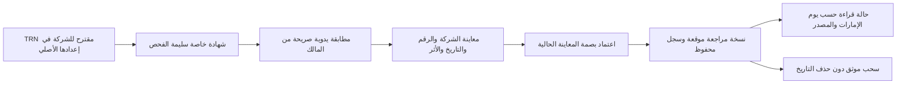

# E75 — مراجعة شهادة التسجيل الضريبي داخل إعداد الشركة القائم

بناء فقط؛ لا نشر أو اتصال بقاعدة التشغيل أو تعديل أرقام حقيقية. لا تحقق آلي من الهيئة ولا اعتماد VAT/CT أو هوية فاتورة إلكترونية.

أعيد استخدام إعداد الضرائب، المستندات الخاصة وعارضPDF والصلاحيات الحالية وسجل التدقيق المشفر. لا أدوار أو دليل حسابات أو ملفات موازية. موظف إعداد الضرائب لا يحصل تلقائياً على سلطة المالك. القارئ يحتاج نطاق الشركة، ولا يحصل من عرض الرقم على معرّف ملف خاص أو تاريخ المراجعات دون الصلاحية الأصلية المناسبة.

رفع الملف أو سلامة فحصه لا يعتمدان التسجيل. يطابق المالك بنفسه الشهادة بالشركة والرقم المقترح، ويعاين البيانات قبل الاعتماد. بصمة المصدر تتغير بتغير المقترح أو الحالة أو المستند؛ أي تعديل بعد المعاينة يبطل الحفظ. تغييرTRN في المسودة يوقف مطابقة المراجعة السابقة دون تعديلها. يمنع اعتماد الرقم نفسه لشركتين في النموذج المستقل المعتمد للمجموعة.

تسجل كل نسخة هوية المنفذ واسمه ووقت الإجراء وسببه والمستند وبصمة النسخة السابقة. نسخة الرأس تطابق السلسلة الأصلية كاملة. التاريخ لا يكتب فوقه؛ الفقد أو التلف يوقف الاستخدام دون إصلاح تلقائي. السحب نسخة جديدة ويحافظ على السابق. القراءة مقيدة100 مراجعة، مع حجز النسخة101 لسحب اعتماد نشط عند الحد؛ لا حذف للسجل.

بدء الاعتماد مستقبلي أو من اليوم؛ يوضح العرض أن المراجعة الجديدة تصبح الحالية وأن الموعد المستقبلي يبقيها معلقة. الانتهاء وسلامة الشهادة ونشاط الشركة وتغير الرقم كلها حالات قراءة بتوقيت الإمارات؛ لا مهام أو Polling أو تغييرات مالية عند حلول التاريخ. إعدادات الفواتير والبنود والضريبة تبقى كما هي، بما فيها فاتورة جديدة بضريبة أصلية صفر بعد مراجعة شهادة.

المراجعة هنا توثيق من المالك فقط: externalAuthorityCheck وtaxTreatmentsApproved وlegalInvoiceIdentityApproved وfilingReady جميعهاfalse. لا يملأ TRN مستنداً تاريخياً مفقود الهوية، ولا يزيل موانعPINT-AE أو يختارASP أو يرسل إقراراً.

## القبول

-9/9 اختبارات مرتبطة، منها ست حالات جديدة: `/tmp/e75-tax-registration-accepted-source.log`. تتضمن التكرار المتزامن وحقول الاعتماد المزورة ورفض غير المالك ونطاق الشركة والمستند، والرقم المكرر، وتغير المقترح وسلامة السلسلة والسحب والصلاحية المستقبلية والانتهاء، وثبات القيود والبنود والحسابات والمنح والإعداد الضريبي الأصلي.
-175 فحصاً ثابتاً، TypeScript وبناء دون مزود سحابي: ناجحة.
-واجهة فعلية AR/EN وثلاثة عروض شاشة: تركيز الحقل المطلوب، PDF خاص فعلي، مطابقة بشرية صريحة، رفض معاينة متأخرة بعد تعديل المدخلات،503 بعد نجاح الحفظ ثم استعادة النسخة ذاتها، سجل وسحب وقارئ بلا أزرار اعتماد أو ملف خاص: ناجحة.
-انحدار ورقةVAT وضريبة الشركات معPDF متعدد الصفحات والواجهة المالية الأصلية: `/tmp/e75-tax-registration-acceptance.log` ناجح. الحقول والرسائل مفهومة وتبقى المدخلات عند الفشل.

لم تراجع أرقام أو شهادات شركات التشغيل فعلياً في هذه الجلسة. العينات وجميع المراجعات والملفات والموظفين في PostgreSQL محلي عشوائي وAuth/Storage وهميين فقط. لم يتغير المصدر الأصلي أو رصيد أو صلاحية. يبقى3.1 جزئياً إلى تحقق البيانات الفعلية، و3.8 جزئياً إلى اكتمال الهوية والقواعد الرسمية وASP. ليست جاهزية لجميع95 أو موافقة نشر.
